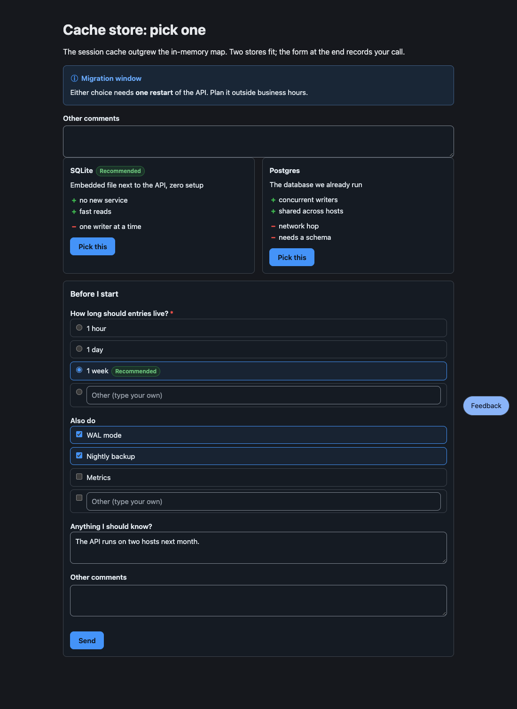
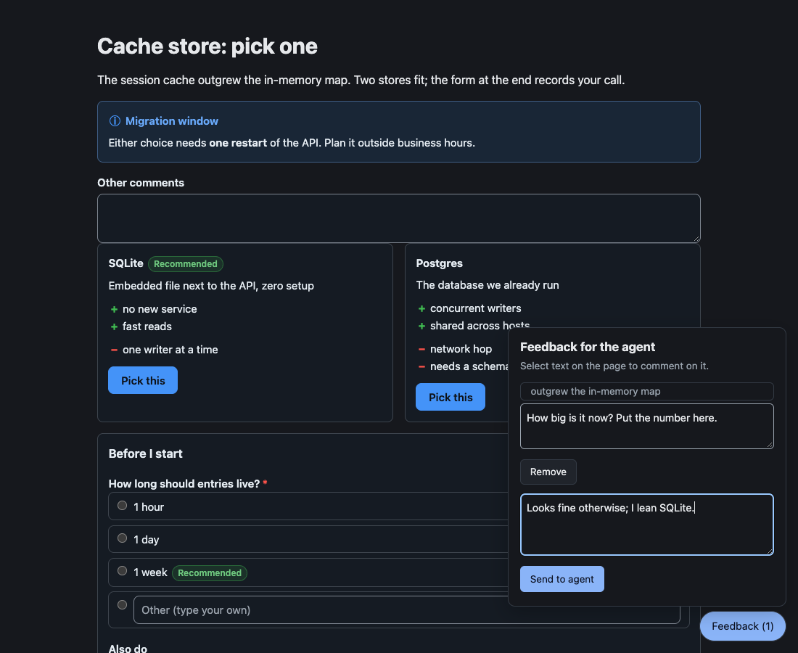
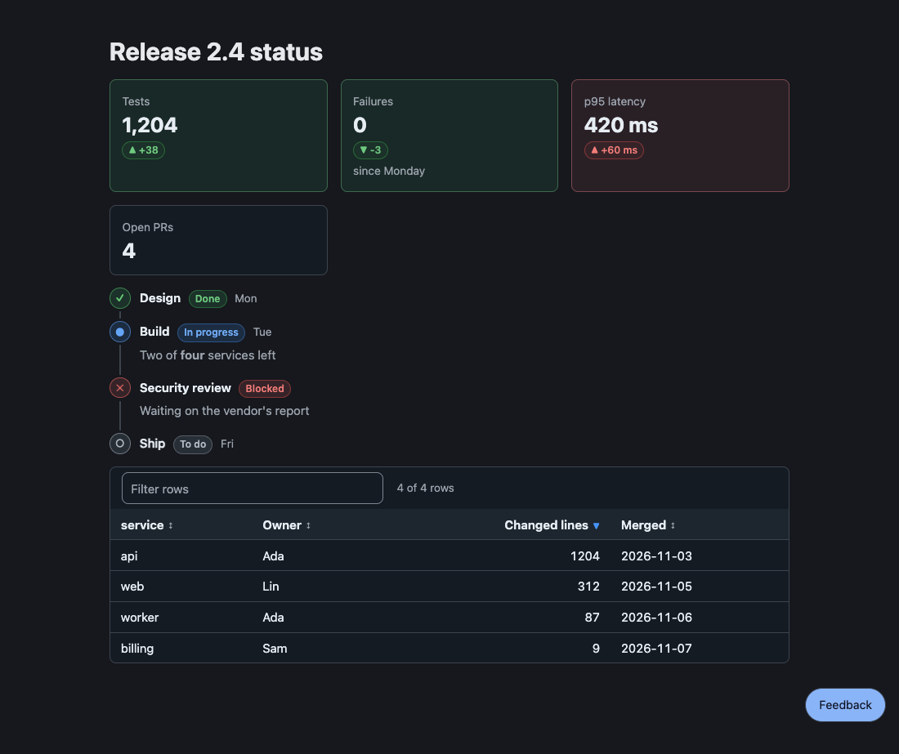
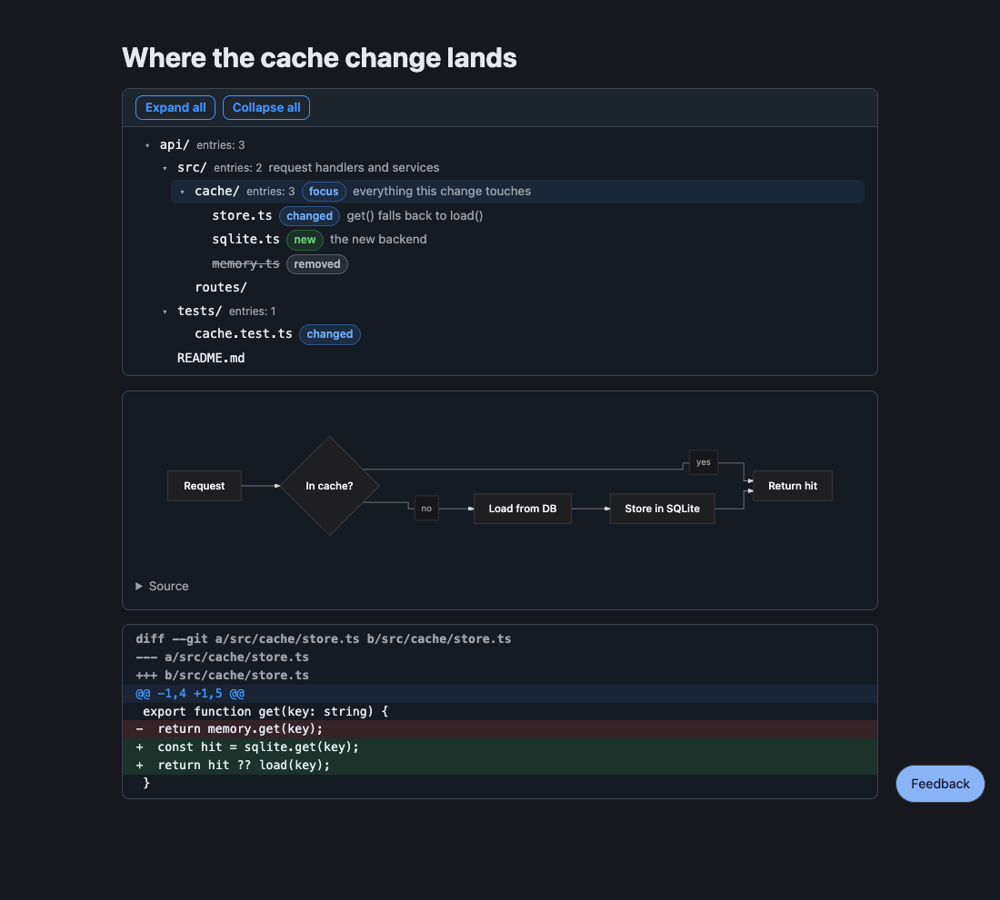
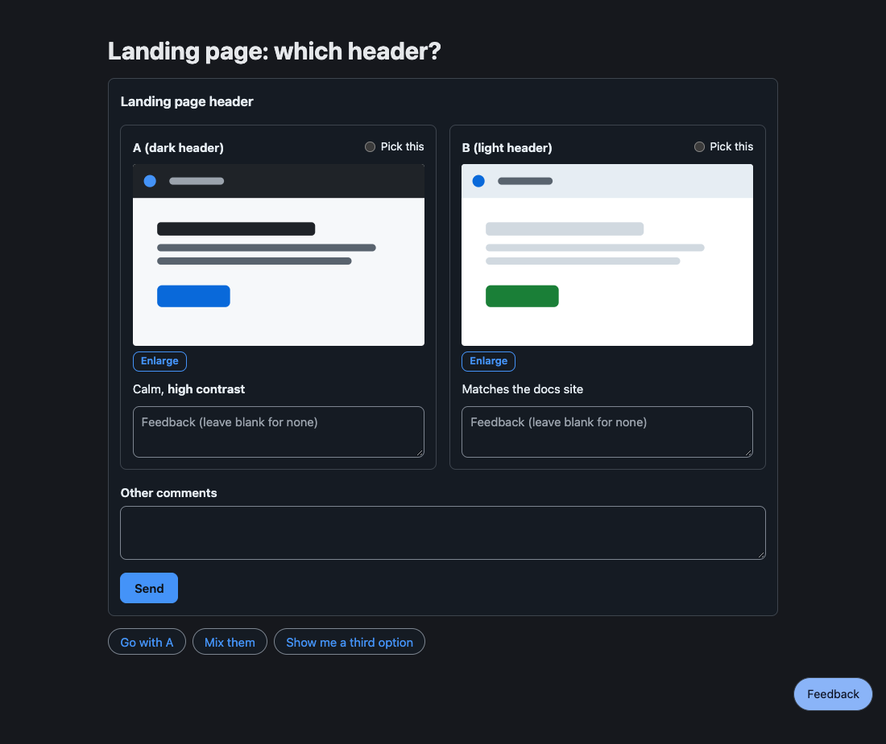

# pi-better-show

Let your pi agent show you a page instead of a wall of text, and answer it by clicking.

The agent writes Markdown with fenced blocks (`` ```options ``, `` ```form ``, `` ```table ``, ...).
`show_doc` opens it in your browser, and every pick, form, or comment you send comes back to the agent as a message.



When you press **Send** on the form above, the agent receives:

```text
User submitted a form in the HTML review pane:
- ttl: week
- extras: WAL mode, Nightly backup
- note: The API runs on two hosts next month.
```

## Fewer tokens

The agent writes data, not a web page: the package owns the layout, styles, controls, and the code that sends answers back.
For the four example pages in this README, writing the blocks took **1,253 output tokens**; asking the same model for one self-contained HTML page with the same content and working controls took **12,364**, about **10 times as many** (90% saved).

| Page | Blocks | HTML page (median) | HTML runs | Saved |
|---|---:|---:|---|---:|
| [Decision](https://github.com/wayne930242/pi-better-show/blob/main/examples/readme-decide.md): alert, options, form | 347 | 2,770 | 1,651 – 2,917 | 87% |
| [Status](https://github.com/wayne930242/pi-better-show/blob/main/examples/readme-status.md): stats, steps, table | 412 | 3,726 | 2,145 – 3,895 | 89% |
| [Structure](https://github.com/wayne930242/pi-better-show/blob/main/examples/readme-structure.md): tree, mermaid, diff | 338 | 3,719 | 3,514 – 4,064 | 91% |
| [Review](https://github.com/wayne930242/pi-better-show/blob/main/examples/readme-review.md): review, suggest | 156 | 2,149 | 2,008 – 2,478 | 93% |
| Total | 1,253 | 12,364 | | 90% |

Counts are Claude output tokens from `claude -p --model claude-sonnet-5-5` (3 to 5 HTML runs per page; the block count is the file echoed back verbatim), measured on 2026-11-10 with `scripts/token-bench.sh`.
None of the HTML pages had the feedback panel for commenting on a selected passage, which `show_doc` adds to every page.
The saving repeats on every revision, since the agent changes a few YAML lines instead of rewriting markup and script.

## Install

```bash
pi install npm:pi-better-show
```

Then `/reload` in a running session.
If you use `pi-herdr-doc-review`, uninstall it first (`pi uninstall npm:pi-herdr-doc-review`): both register `show_doc`.

## What `show_doc` does

`show_doc({paths, reason, view})` returns at once; the agent does not wait for you.

- `view: "page"` opens the file in your default browser.
  Markdown renders with its blocks; `.html`, `.tsx`, and `.jsx` run in a sandboxed frame; images show as they are.
- `view: "edit"` (the default) opens the file in your editor.
  Your saves reach the agent as one net diff per file, without starting a turn.
- Select any passage on a page to comment on it, or click a node or an edge in a flowchart or state diagram.
  The feedback panel sends your comments and an overall note in one message; a diagram comment names the diagram and the element, such as `[Diagram 2, stateDiagram-v2] edge: Paid → Refunded "money back"`.
- Open pages reload when the agent edits the file.



## Blocks

A block is a fenced code block whose first word is its kind, or a GitHub alert (`> [!NOTE]`).
Most take YAML; text fields take bold, italic, code, and `http(s)` links, never raw HTML.

| Kind | Shows | You answer by |
|---|---|---|
| `alert` | a callout (`NOTE`, `TIP`, `IMPORTANT`, `WARNING`, `CAUTION`) | |
| `options` | choices side by side, with pros and cons | picking one |
| `form` | single, multi, and text questions | Send |
| `review` | designs, screenshots, or prototypes to compare | commenting and picking |
| `checklist` | items to tick | Send |
| `suggest` | quick-reply chips | clicking one |
| `cards`, `stats` | tiles with a tone | |
| `steps` | a timeline with status | |
| `table` | sortable, filterable rows | |
| `tree` | a directory tree with tags and notes (`npx pbs-tree` prints one) | |
| `mindmap` | a collapsible outline | |
| `mermaid`, `diff` | a diagram, a coloured diff | |

A status page with `stats`, `steps`, and `table`:



A structure review with `tree`, `mermaid`, and `diff`:



A design review with `review` and `suggest`:



A block that does not parse shows its source and the reason on the page, and the agent's `write` and `edit` results list the problem with its line number.

## Outside pi

The block vocabulary is a library too, so other hosts (a GUI, a chat bridge) draw the same blocks and send the same answers:

| Entry | For |
|---|---|
| `pi-better-show` | `parse`, `toText` (a plain-text or Discord fallback), `encodeAnswer`, `validateAnswer`, `checkBlocks` |
| `pi-better-show/elements` | framework-free custom elements, one per block kind |
| `pi-better-show/react` | React wrappers over the elements |
| `pi-better-show/server` | Mermaid to SVG and to Unicode text |

The [reference](https://github.com/wayne930242/pi-better-show/blob/main/docs/reference.md) covers every block's schema, these APIs, theming tokens, and the extension's event bus.

## Development

```bash
bun install
bun test
bun run check    # tsc, tsc for core without node types, biome
bun run demo     # examples/elements.html on http://127.0.0.1:4177/
bun run show     # the show_doc page server on examples/, with a fake pi that prints each message
```

## License

MIT
