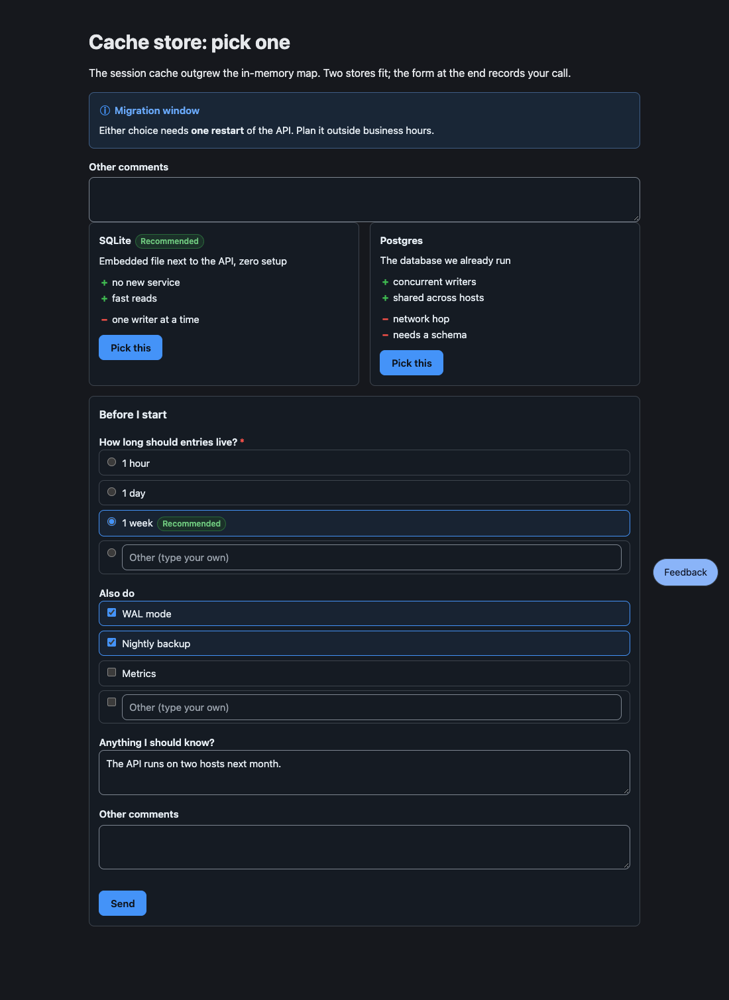

# pi-better-show

[English](README.md)

**讓你的 [pi](https://github.com/earendil-works/pi) agent 給你一個頁面，而不是一大堆文字，你點一點就能回答。**

**[文件](https://wayne930242.github.io/pi-better-show/zh-tw/)** 有繁體中文與 [English](https://wayne930242.github.io/pi-better-show/) 兩種版本：概念、每一種區塊、agent 頁面與函式庫。



## 為什麼

- **寫區塊，不寫標記。** agent 每個區塊只寫幾行 YAML；版面、控制項，以及把答案送回去的程式碼，都由套件負責。
- **答案以訊息送回。** 一次挑選、一份表單、對段落或圖上節點的留言：一則固定格式的訊息。
- **省下約 10 倍 token**，相較於把同樣的頁面寫成 HTML（實測 1,253 對 12,364 個輸出 token）。
- **每個宿主共用一套詞彙。** Core、自訂元素與 React 包裝共用同一個剖析器、同一套純文字備援與同一種答案編碼。

## 安裝

```bash
pi install npm:pi-better-show
```

接著在執行中的 session 裡 `/reload`。如果你用 `pi-herdr-doc-review`，請先移除它（`pi uninstall npm:pi-herdr-doc-review`）：兩者都註冊 `show_doc`。

## 快速開始

請 agent 給你看點東西。它會寫一個帶區塊的 Markdown 檔並呼叫 `show_doc({paths, reason, view})`，呼叫會立刻回傳：

- `view: "page"` 在瀏覽器開啟檔案；選取一段文字，或點圖上的節點，就能留言。
- `view: "edit"`（預設）在你的編輯器開啟；你的儲存會以每個檔案一份淨 diff 送到 agent。

你在表單按下 **Send**，agent 收到：

```text
User submitted a form in the HTML review pane:
- ttl: week
- extras: WAL mode, Nightly backup
```

## 區塊

| 種類 | 顯示 | 你的回答方式 |
|---|---|---|
| `alert`、`cards`、`stats` | 帶語氣的提示與方塊 | |
| `options` | 附優缺點的選項 | 挑一個 |
| `form` | 單選、多選與文字問題 | Send |
| `review` | 要比較的設計或原型 | 留言、挑選 |
| `checklist`、`suggest` | 要勾選的項目、快速回覆 chip | Send、點擊 |
| `table`、`steps`、`tree`、`mindmap` | 可排序的列、時間軸、目錄樹、大綱 | |
| `mermaid`、`diff` | 可以留言的圖、上色的 diff | |

HTML 與 TSX 頁面、`pbs-tree` CLI、函式庫進入點與每個 schema 都在[文件](https://wayne930242.github.io/pi-better-show/zh-tw/reference/blocks/)裡。

## 開發

```bash
bun install
bun test
bun run check    # tsc, tsc for core without node types, biome
bun run demo     # every element, on http://127.0.0.1:4177/
cd site && npm ci && npm run check && npm run build   # the documentation site
```

## 授權

MIT
