# pi-better-show reference

The full contract behind the [README](../README.md): every block kind, the core, server, element, and React APIs, and the details of the `show_doc` extension. Find the section you need and skip the rest.

pi-better-show is one block vocabulary, with one parser, one text fallback, and one answer encoding shared by every host that draws it. The pi extension is one such host; a GUI or a chat bridge can be another.

```text
pi-better-show            core: isomorphic, no DOM, no node APIs; depends on `yaml` only
pi-better-show/elements   browser: framework-free custom elements, one per block kind (no yaml, no node APIs)
pi-better-show/react      thin React wrappers over the elements (React is an optional peer)
pi-better-show/server     node: Mermaid to SVG and to Unicode text (beautiful-mermaid)
pi-better-show/extension  the pi extension: `show_doc`, a loopback page server, edit mode, event-bus contract v2
```

| Entry | What it does | Section |
| --- | --- | --- |
| `pi-better-show` | Parses Markdown into blocks, writes them as text, encodes and validates answers. | [Blocks](#blocks), [Core API](#core-api) |
| `pi-better-show/server` | Draws Mermaid as SVG or as Unicode text. | [Server API](#server-api) |
| `pi-better-show/elements` | Draws each block as a custom element and fires `pbs-answer`. | [Elements](#elements) |
| `pi-better-show/react` | Wraps the elements for React. | [React](#react) |
| `pi-better-show/extension` | The `show_doc` tool, the page server, edit mode, and the event bus. | [The pi extension](#the-pi-extension) |

The package ships TypeScript source, with no build step. Source uses erasable syntax only, so it loads under node's type stripping and in bun and bundler pipelines. Design: `docs/specs/2026-11-07-better-show/spec.md`.

## Blocks

A block is data the agent writes instead of markup: it names what to show, and the host draws it, so the agent never writes layout, styles, or the script that sends an answer back.
A block is a fenced code block whose first word is the kind, or a GitHub alert; the fence may use backticks or tildes. Most kinds take YAML. Text fields (`body`, `hint`, `note`, ...) take restricted inline Markdown: bold, italic, code, `http(s)` links, line breaks. No raw HTML anywhere.

<details>
<summary>Every kind at a glance</summary>

| Kind | Written as | Answer kind |
|---|---|---|
| `alert` | `> [!NOTE\|TIP\|IMPORTANT\|WARNING\|CAUTION] title` quote | |
| `mermaid` | Mermaid source | |
| `diff` | unified diff | |
| `cards` | YAML list of `{title, tone, body}` | |
| `options` | YAML list of `{title, recommended, body, pros, cons}` | `pick` |
| `form` | YAML `{title, submit, questions: [{name, label, type, hint, required, other, choices}]}` | `form` |
| `review` | YAML `{title, submit, pick, columns, items: [{name, label, image, page, height, body}]}` | `review` |
| `mindmap` | indented Markdown list; the first item is the root | |
| `suggest` | YAML list of strings or `{label, text}` | `suggest` |
| `checklist` | YAML `{title, submit, items: [string \| {name, label, checked, note}]}` | `checklist` |
| `table` | YAML `{columns, rows, sort, filter}` | |
| `steps` | YAML `{items: [{title, status: done\|doing\|todo\|blocked, when, body}]}` | |
| `stats` | YAML list of `{label, value, delta, tone, note}` | |
| `tree` | indented lines (two spaces per level, first line the root): `name/` for a folder, then `{tags}` and ` # note` | |

</details>

Four example pages, each mixing kinds:

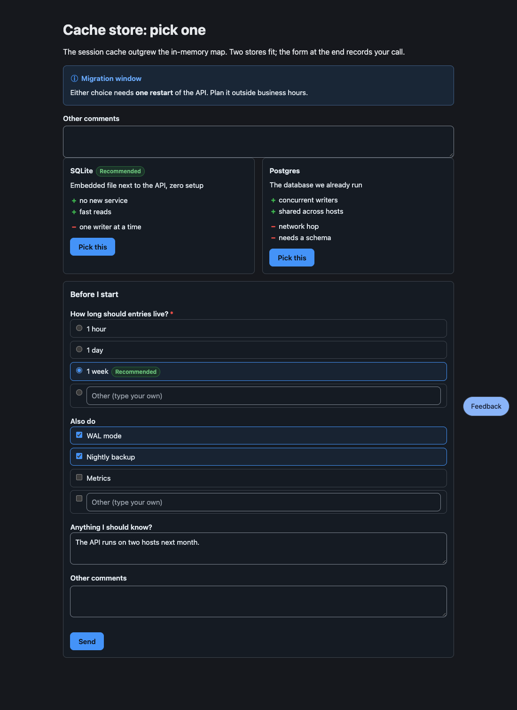

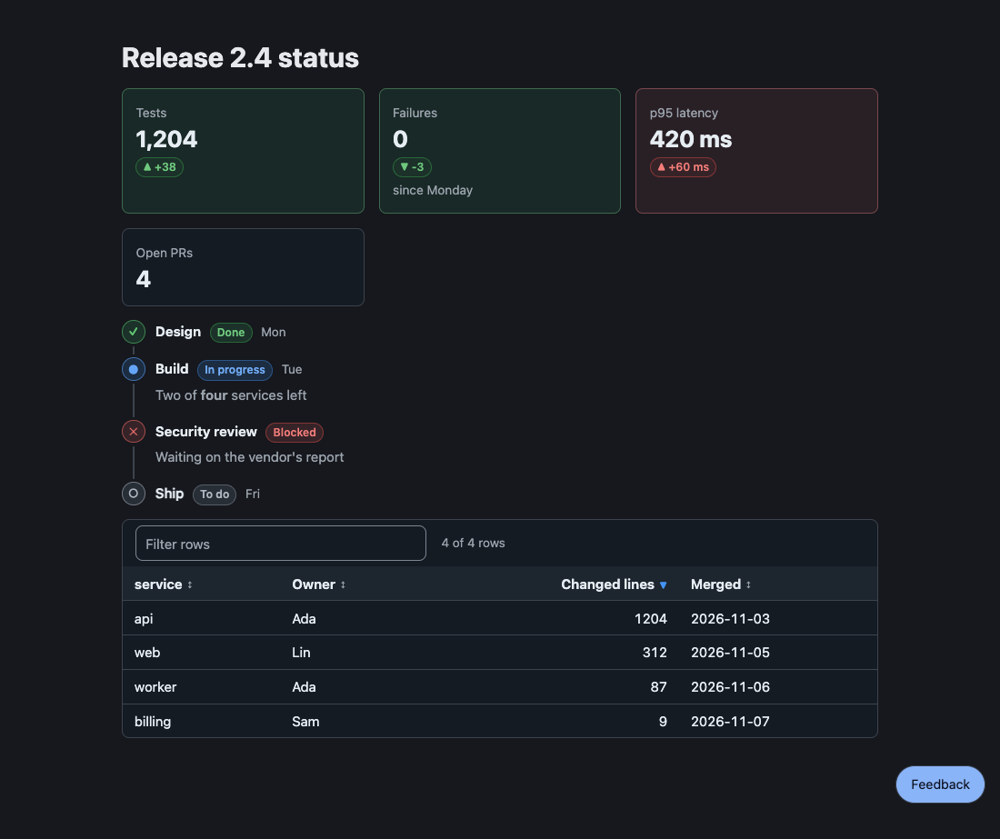

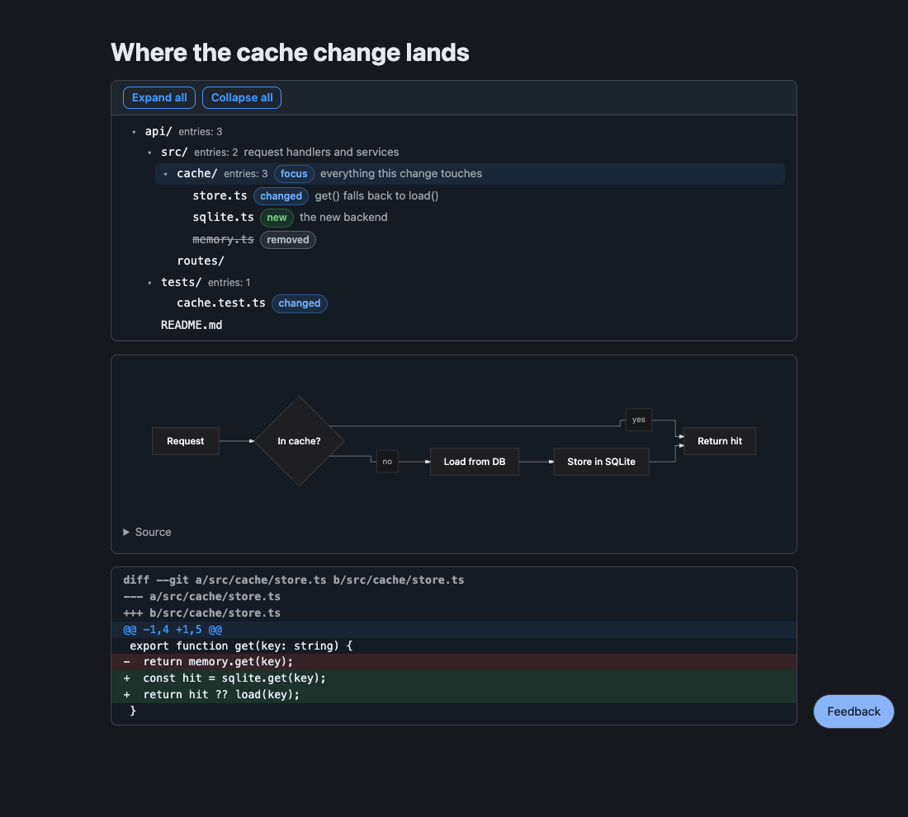

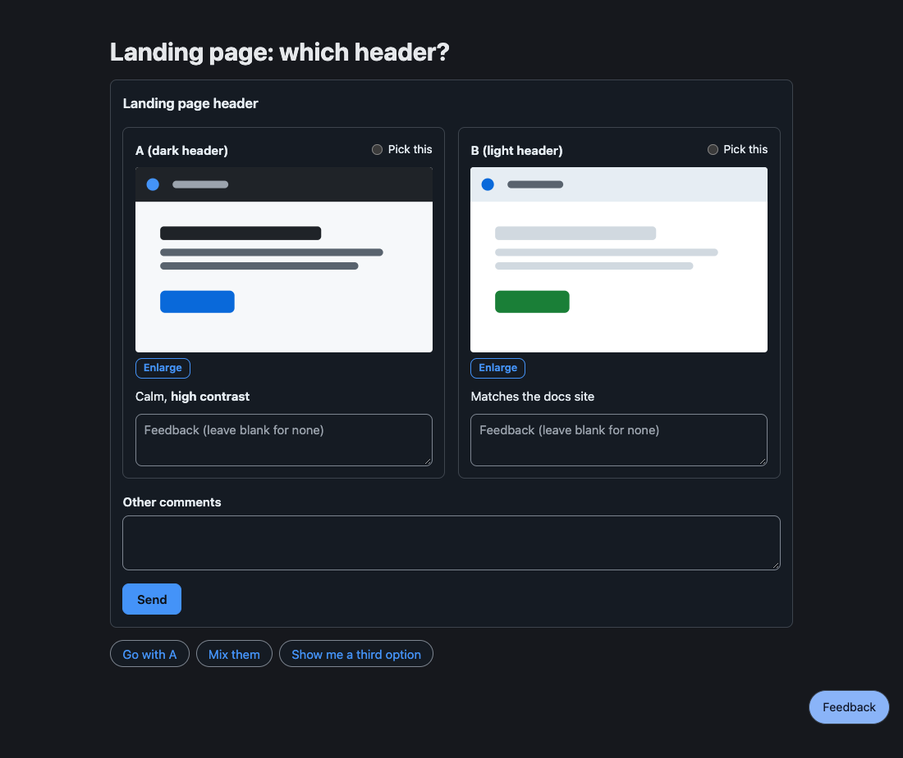

A block that does not parse becomes an `invalid` segment that keeps its source and the reason; nothing throws, and the page shows the source with the reason.

### Alert

A callout for what the reader must not miss: a GitHub alert, as in a README.

~~~markdown
> [!WARNING] Heads up
> This **overwrites** the cache, see [the runbook](https://example.com/runbook).
~~~

The kinds are `NOTE`, `TIP`, `IMPORTANT`, `WARNING`, and `CAUTION`; the text after the marker is the title, and without it the title is the kind's name. The body is inline Markdown over several lines. It takes no answer.

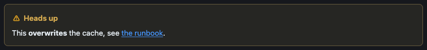

### Cards

Short tiles side by side, each with a tone (`note`, `ok`, `warn`, `risk`) that shows as a tint, a badge, and an icon, never as a coloured edge.

~~~markdown
```cards
- {title: Speed, tone: ok, body: "**2x** faster than the old path"}
- {title: Risk, tone: warn, body: "Needs a migration window"}
```
~~~

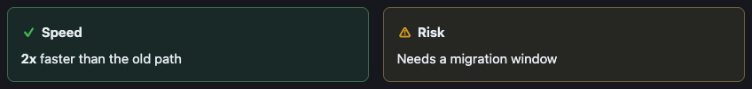

It takes no answer.

### Options

Choices side by side with pros and cons; the reader picks one, and the pick is the answer.

~~~markdown
```options
- title: SQLite
  recommended: true
  body: Embedded, zero setup
  pros: [simple, fast]
  cons: [single writer]
- title: Postgres
  body: A server to run
  pros: [concurrent writers]
  cons: [more to operate, needs backups]
```
~~~

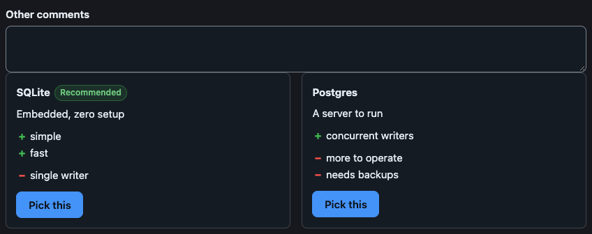

The agent receives, as soon as the reader picks (the element then locks itself):

```text
User picked "SQLite".
```

<details>
<summary>Fields and details</summary>

- `title` and `body` take inline Markdown; `recommended` is `true` (the badge reads "Recommended") or a label of your own; `pros` and `cons` are lists of strings.
- The answer names the option by its plain title, else by its number (1 for the first).
- A pick sends at once, so there is no Send button. The "Other comments" box above the options is read when the option is picked (see [Other comments](#other-comments)).

</details>

### Form

Several questions answered in one go: single choice, multiple choice, or free text. Send delivers every answer in one message.

~~~markdown
```form
title: Before I start
submit: Send
questions:
  - name: ttl
    label: How long should entries live?
    required: true
    choices: [1 hour, 1 day, {value: week, label: 1 week, recommended: true}]
  - name: extras
    label: Also do
    type: multi
    choices: [WAL mode, Nightly backup, Metrics]
  - name: note
    label: Anything I should know?
```
~~~

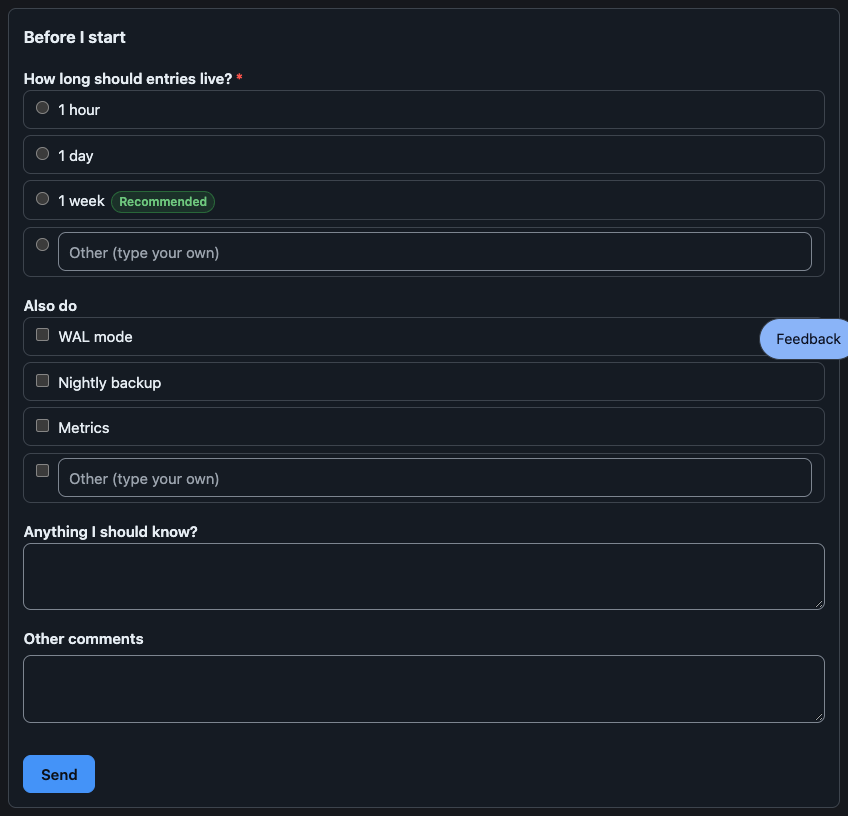

The agent receives:

```text
User submitted a form in the HTML review pane:
- ttl: week
- extras: WAL mode, Nightly backup
- note: The API runs on two hosts next month.
```

<details>
<summary>Fields and details</summary>

- A question has a `name` (the key in the answer; it defaults to the label), a `label`, an optional `hint`, and `required`. Its `type` is `single` (the default when it has `choices`), `multi`, or `text` (the default without `choices`).
- A `choices` entry is a string, or `{value, label, note, recommended}`.
- `other` adds a box for an answer of the reader's own: a label for the box, or `false` to remove it. A choice question ends with such a box unless `other: false`.
- A required question must be answered before Send. A question left empty is sent as `(no answer)`.
- The form stays editable after sending, so the reader can send a changed answer.

</details>

### Review

Designs, screenshots, or prototypes to compare: the reader comments on each item and, when `pick` is set, picks a favourite.

~~~markdown
```review
title: Landing page
pick: true
columns: 2
items:
  - {name: A, label: dark header, image: a.svg, body: "Calm, **high contrast**"}
  - {name: B, label: light header, image: b.svg}
```
~~~

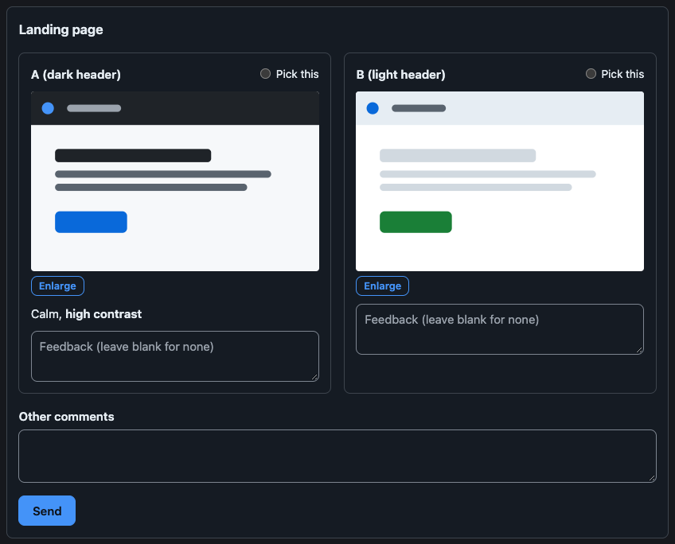

The agent receives the picked item, each commented item with its comment, and the items left blank:

```text
User reviewed "Landing page":
Picked: A (dark header)
- A (dark header): The contrast is right.
No feedback on: B (light header)
```

<details>
<summary>Fields and details</summary>

- `image` is a path relative to the Markdown file (an item may be just that path); `page` is the path of an HTML prototype, shown in a sandboxed frame of `height` pixels. Neither may leave the page's directory.
- Items are named A, B, C... unless `name` says otherwise; the answer writes `name (label)`.
- `pick: true` shows a radio per item (a string sets its label); `columns` is 1 to 6.
- A blank comment box means no feedback, so a review with every box blank is still an answer.
- A picture opens enlarged in a lightbox.

</details>

### Mindmap

A collapsible outline: an indented Markdown list whose first item is the root.

~~~markdown
```mindmap
- Release
  - Build
    - bundle
    - sign
  - Ship
    - tag
```
~~~

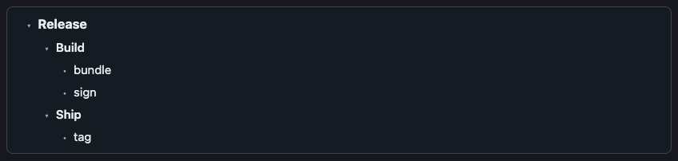

A mindmap has one root; indent the other top-level items under it. It takes no answer. Arrow keys move, Right and Left open and close, Enter and Space toggle.

### Suggest

Quick-reply chips: clicking one sends its text as the reader's own message.

~~~markdown
```suggest
- Go ahead
- {label: Not now, text: "Not now, ask me tomorrow"}
```
~~~

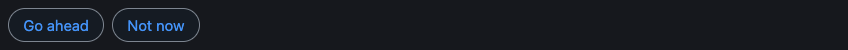

The agent receives the chip's text itself: `Not now, ask me tomorrow`. A string chip's label and text are the same.

### Checklist

Items to tick; the ticked and unticked items come back together.

~~~markdown
```checklist
title: Before release
items:
  - {label: Run tests, checked: true}
  - {label: Bump version, note: semver}
```
~~~

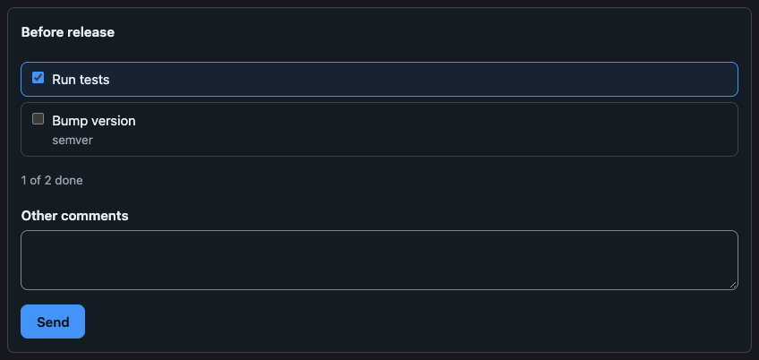

The agent receives:

```text
User updated the checklist "Before release":
☑ Run tests
☐ Bump version
```

An item is a string or `{name, label, checked, note}`; the answer names it by `name`, which defaults to its label.

### Table

Sortable, filterable rows.

~~~markdown
```table
columns:
  - name
  - {name: size, label: Size, type: number}
  - {name: day, label: Shipped, type: date}
rows:
  - [alpha, 1204, 2026-03-01]
  - [beta, 2, 2026-01-15]
sort: -size
filter: true
```
~~~

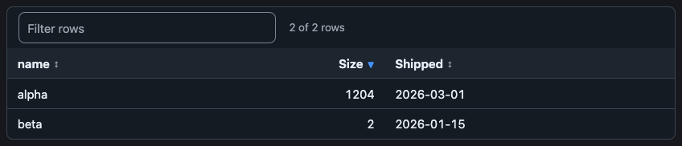

It takes no answer. A column is a name or `{name, label, align, type: text|number|date}`; a row is a list in column order or a map by column name. `sort` names a column, with a leading `-` for descending; `filter: true` adds a search box.

### Steps

A timeline with a status per step.

~~~markdown
```steps
items:
  - {title: Design, status: done, when: Mon}
  - {title: Build, status: doing, when: Tue, body: "Two of **four** services left"}
  - {title: Legal review, status: blocked, body: Waiting on the vendor}
  - {title: Ship, status: todo}
```
~~~

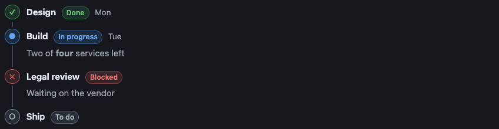

It takes no answer. `status` is `done`, `doing`, `todo`, or `blocked`.

### Stats

Metric tiles with an optional change and tone.

~~~markdown
```stats
- {label: Users, value: "1,204", delta: "+4%", tone: ok}
- {label: Latency p95, value: 420 ms, delta: "+60 ms", tone: risk}
```
~~~

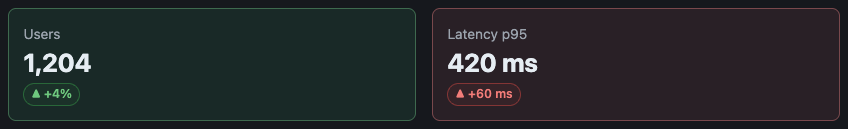

It takes no answer.

### Diff

A coloured unified diff.

~~~markdown
```diff
@@ -1,4 +1,5 @@
 export function get(key: string) {
-  return store.get(key);
+  const hit = store.get(key);
+  return hit ?? load(key);
 }
```
~~~

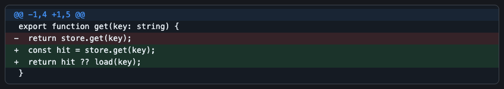

It takes no answer.

### Mermaid

A diagram, drawn on the server in the page's colour scheme. Flowcharts and state diagrams can be commented on node by node (see [Markdown pages](#markdown-pages)).

~~~markdown
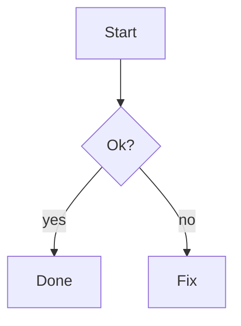
~~~

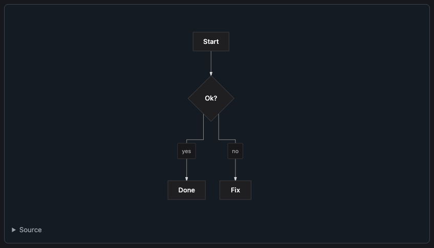

It takes no answer of its own. Flowchart, state, sequence, class, ER, and xychart diagrams draw; use a flowchart for flows and concept maps.

### Tree

A directory tree for structure reviews, with folders that collapse and expand:

```tree
pi-better-show/
  src/ # one package, four entries
    core/ {focus} # parser and text, no DOM
      parse.ts
      validate.ts {new} # checks answers
    elements/ # web components
  tests/
  README.md {changed}
```

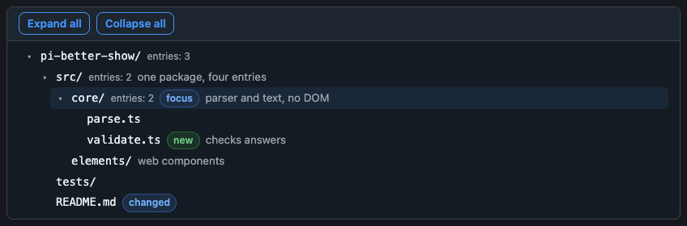

A folder's name ends with `/`; tags are `new`, `changed`, `removed`, `focus`, `risk` (an unknown tag makes the block invalid); the note after ` # ` takes inline Markdown; a `… N more` line stands for entries a limit cut. It takes no answer.

<details>
<summary>Limits and fallback</summary>

A tree has at most 2,000 nodes and 32 levels (the root is level 1). The block carries a snapshot, so every host draws it; `toText` writes it in `tree` style (`├──`, `└──`, tags as `[new]`, notes after ` — `), in a fence on Discord.

</details>

### pbs-tree

`pbs-tree` prints the `tree` fence for a folder: `npx pbs-tree [dir]` or `bunx pbs-tree [dir]` (plain JavaScript on node built-ins; runs under node and bun). Output is sorted by name in byte order, so a snapshot is reproducible; symlinks are not followed. Flags follow Linux `tree` where they exist:

| Flag | Meaning |
|---|---|
| `-L n` | depth |
| `-d` | folders only |
| `-a` | include dot files (default skips them; `.git` is always skipped) |
| `-I pattern` | leave out names matching the glob (`*` `?` `[..]`); `\|` separates several; repeatable |
| `-P pattern` | list only files matching; a folder is kept when it holds a match (even below the `-L` cut); ignored with `-d` |
| `--gitignore` | honour `.gitignore` files, those of the folder and of the folders above it up to the repository's top |
| `--dirsfirst` | folders before files |
| `--filelimit n` | do not open a folder holding more than n entries; writes `… N more` in its place |
| `--prune` | drop folders that hold nothing (what `-L` hides still counts); ignored with `-d` |
| `--changed-since <rev>` | tag `new`, `changed`, `removed` from `git diff --name-status <rev>` against the working tree; removed files are listed though absent, untracked files are `new`, a rename is a removed and a new file |

<details>
<summary>Limits and exit codes</summary>

A tree over the block's limits is refused (exit 1) with the node count; narrow it with `-L`, `-I`, `--gitignore`. Names that would read as a note or tags get a no-break space, and a newline in a name becomes `?`. Exit codes: 0, 1 for a failure (not a folder, git failed, too large), 2 for a bad flag.

</details>

### Other comments

Every submittable element (`pbs-form`, `pbs-review`, `pbs-checklist`, `pbs-options`) shows a fixed "Other comments" box above its submit button (above the options in `pbs-options`; the box is read when the option is picked). Its trimmed text travels in the same answer as the reserved field `pi-note` (`NOTE_FIELD`), once, and a blank box sends nothing; the agent reads it as a last line, `Other comments: …`.

<details>
<summary>For hosts</summary>

`validateAnswer` accepts `pi-note` for every interactive kind; a form question or checklist item may not be named `pi-note`. A host that shows the elements needs to do nothing new: the field is in `answer.fields`, so `validateAnswer` and `encodeAnswer` already pass it through. A host that rebuilds the answer from selected fields must forward `pi-note`; set `answered` to the submitted fields so the locked element shows it. The words are `otherComments` in `configure({strings})`.

</details>

### Several values

A block that gathers several values (a `form` with a `multi` question, a `checklist`, a `review`) sends nothing on a tick, a pick, or typing: choices stay changeable until the reader presses Send, and a required `multi` question with none chosen is refused at that question. Only `options` and `suggest` send on the click.

## Core API

Core is the whole vocabulary without a screen: it parses Markdown into segments, writes them as plain text, and encodes the answers a reader gives. It touches no DOM and no node API, so it runs wherever JavaScript does.

```ts
import { parse, toText, inline, encodeAnswer, checkBlocks } from "pi-better-show";
```

### Parse

```ts
parse(markdown: string): Segment[]
```

Splits a document into `{type: "markdown", text}`, `{type: "block", kind, data, index}`, and `{type: "invalid", kind, source, error}` segments, in order. `data` is typed per kind (`BlockDataMap`). `index` counts the document's blocks of every kind from 0; invalid blocks take no number. `index` is the block's address for answers.

### Check

Tells the author what is wrong with the blocks of a file, where `parse` only keeps going.

```ts
checkBlocks(markdown: string, options?: { mermaid?: (source: string) => string | undefined }): BlockProblem[]
formatProblems(name: string, problems: BlockProblem[]): string

interface BlockProblem {
  kind: BlockKind;
  line: number;                      // 1-based, in the Markdown file
  path: string;                      // e.g. form question "o5" choice 1 label
  message: string;
  severity: "error" | "warning";
}
```

<details>
<summary>What is an error, and what is a warning</summary>

`error`: the block is invalid and the page shows its source (a YAML error is reported at the line that caused it; a flow collection broken by an unquoted ` #` points at the line that opened it). `warning`: the block draws, but part of what was written is lost: a plain value that a ` #` cut short (YAML reads the rest as a comment; the message names the key path and says to quote the value), a key the block does not read at that level (with the known keys, and a "did you mean" for a near miss), or a fence that never closes. Core has no Mermaid parser: pass `options.mermaid`, which returns what is wrong with a diagram source, to check diagrams too. Pure; it loads no more than `parse` does.

</details>

### Text fallback

Renders a document for a surface that cannot draw blocks: Discord, LINE, a terminal.

```ts
toText(segments: Segment[], profile: TextProfile): string

interface TextProfile {
  flavor: "discord" | "line" | "plain";   // Discord Markdown, or plain text
  width?: number;                          // columns a diagram may take; default 60
  mermaid?: (source: string, width: number) => string | undefined;
  keep?: readonly BlockKind[];             // kinds emitted as their `raw` text instead of converted
  lang?: "en" | "zh-TW";                   // language of the reply instructions; default "en", anything else is "en"
}
```

<details>
<summary>Reply instructions, `raw`, and the diagram hook</summary>

The interactive kinds end with a reply instruction (`options`, `form`, `review`, `suggest`, and `checklist`): "Reply with a number.", "Reply in text, one line per question, like `1: b`.", and so on. `lang: "zh-TW"` writes them in Traditional Chinese; pass the conversation's language when you know it. Block content is never translated.

Every `BlockSegment` and `InvalidSegment` carries `raw`: the block's exact original text, fences (or an alert's whole `>` quote) included, byte for byte. Kinds listed in `keep` are emitted as `raw` verbatim, valid or invalid, for a surface that draws them itself; other kinds convert as usual. `DISPLAY_KINDS` (`alert`, `cards`, `mermaid`, `mindmap`, `diff`, `table`, `steps`, `stats`, `tree`) is the usual `keep` list for such a surface; `INTERACTIVE_KINDS` (`options`, `suggest`, `form`, `checklist`, `review`) are the kinds a reader answers, the ones a surface that cannot draw them gets as reply instructions. Without `keep`, output is unchanged.

Renders a document for a surface that cannot draw blocks. A diagram goes through the `mermaid` hook; when there is no hook, or it returns `undefined` or a drawing wider than `width`, the output is the Mermaid source in a code block plus a pointer to the web view. No block-kind fence is left in the output, except Discord's native `diff`.

</details>

### Answers

An answer is a kind and a list of `[name, value]` fields; `encodeAnswer` turns it into the text the agent reads.

```ts
inline(text: string): InlineToken[]      // restricted inline Markdown, tokenized, never HTML
inlinePlain(text: string): string        // the same text without markers
displayWidth(text: string): number       // terminal columns: CJK counts 2
reviewItemName(item): string             // "B (dark header)"

interface Answer {
  kind: "form" | "review" | "feedback" | "pick" | "suggest" | "checklist";
  title?: string;
  fields: [name: string, value: string][];
  ref?: { doc?: string; block: number };
}
encodeAnswer(answer: Answer): string
```

`encodeAnswer` produces the text the agent reads. For `form`, `review`, and `feedback` it is byte-compatible with pi-herdr-doc-review's `formMessage`, `reviewMessage`, and `pageFeedbackMessage` given the same fields (the legacy `pi-kind` field is ignored). `ref` addresses the block for hosts and does not appear in the text. A `pi-note` field (see below) is appended as `Other comments: …`.

| Kind | `fields` | Text |
|---|---|---|
| `form` | one `[name, value]` per question | `User submitted a form ...` then `- name: value` lines |
| `review` | `title`, `picked`, `item`/`comment` pairs, `silent` | `User reviewed "title":` ... |
| `feedback` | `page`, `quote`/`comment` pairs, `overall` | `User feedback on the page "page":` ... (a quote is a selected passage, or a diagram element, see Markdown pages) |
| `pick` | `[["picked", option]]` | `User picked "option" for "title".` |
| `suggest` | `[["text", text]]` | the text itself |
| `checklist` | one `[name, "checked" \| "unchecked"]` per item | `User updated the checklist "title":` then `☑`/`☐` lines |

### Validate answers

For a host that receives an `Answer` from an untrusted client: `validateAnswer` says whether it fits the block it claims to answer.

```ts
validateAnswer(block: BlockSegment, answer: Answer): { ok: true } | { ok: false; reason: string }
```

<details>
<summary>What is accepted</summary>

`validateAnswer` is for a host that receives an `Answer` from an untrusted client. It accepts the answer when its `kind` fits the block (`options` takes `pick`, the others their own kind), every field names a question, choice, or item of that block, and there are at most 64 fields of at most 1,024 characters each. Several values for one name are accepted only for a `multi` form question (as repeated fields, or the joined value the form element sends); a `single` or `text` question, a pick, and a suggestion take one. A required question must be answered (an empty value or `(no answer)` is not an answer). On a `form` question without an `other` box, a value must be one of its choices. A `checklist` field is an item name once with `checked` or `unchecked`; a `review` may carry `picked` only when the block has `pick`. On refusal `reason` says why, for the host's error reply. Blocks that take no answer (display kinds) are refused.

</details>

## Server API

The server entry draws Mermaid for hosts that cannot: as a self-contained SVG for a page, or as Unicode box drawing for a text surface.

```ts
import { mermaidSvg, mermaidText } from "pi-better-show/server";

mermaidSvg(source: string, options?: { scheme?: "light" | "dark" | DiagramColors; font?: string; transparent?: boolean }): string
mermaidText(source: string, width = 60): string | undefined
```

`mermaidSvg` draws a self-contained SVG in the colours of `scheme` (use real colours; an image URL cannot read the host page's CSS). It has no `@import` and no `<script>`, and throws on a source it cannot draw. `mermaidText` draws Unicode box drawing, and returns `undefined` when the source is invalid, a line is wider than `width`, or a wide (CJK, emoji) character would misalign the boxes. It is the `mermaid` hook for `toText`:

```ts
toText(parse(reply), { flavor: "discord", mermaid: mermaidText });
```

## Elements

The elements are the browser half of the vocabulary: one framework-free custom element per block kind. A host gives each its parsed `data` and listens for one event, `pbs-answer`.

### Using an element

```ts
import "pi-better-show/elements";           // defines every pbs-* tag (a no-op without a DOM)
import { configure } from "pi-better-show/elements";

el.data = segment.data;                      // or <pbs-form data-json='{...}'>
el.addEventListener("pbs-answer", (event) => send(encodeAnswer(event.detail)));
el.answered = event.detail.fields;           // once delivered: locks the element and shows what was sent
```

A host gives an element the block's parsed `data` and listens for `pbs-answer` (bubbles, composed, cancelable) whose `detail` is a core `Answer`. An element never reads or writes HTML: text reaches the page as text nodes, and links are `http(s)` only with `rel="noopener noreferrer"` and `target="_blank"`. Each element is a shadow root with constructed stylesheets (`adoptedStyleSheets`), so it runs under `default-src 'self'`: no `<style>` element, no `style` attribute. `examples/` is such a page; run it with `bun run demo` (loopback, port 4177).

### Tags

| Tag | Block | `data` | Answer | Parts |
|---|---|---|---|---|
| `pbs-callout` | `alert` | `AlertData` | | `callout` `header` `icon` `title` `body` |
| `pbs-cards` | `cards` | `CardsData` | | `grid` `card` `title` `icon` `body` |
| `pbs-options` | `options` | `OptionsData` | `pick` | `grid` `option` `title` `badge` `body` `pros` `cons` `actions` `pick` `status` |
| `pbs-form` | `form` | `FormData` | `form` | `form` `title` `question` `label` `hint` `choices` `choice` `badge` `other` `textarea` `error` `actions` `submit` `status` `sent` |
| `pbs-review` | `review` | `ReviewData` | `review` | `review` `title` `items` `item` `item-title` `pick` `media` `image` `enlarge` `frame` `unavailable` `body` `comment` `actions` `submit` `status` `lightbox` `close` `sent` |
| `pbs-mindmap` | `mindmap` | `MindmapData` | | `mindmap` `tree` `item` `node` `toggle` `label` `group` |
| `pbs-suggest` | `suggest` | `SuggestData` | `suggest` | `suggest` `chips` `chip` `status` |
| `pbs-checklist` | `checklist` | `ChecklistData` | `checklist` | `checklist` `title` `items` `item` `progress` `actions` `submit` `status` `sent` |
| `pbs-table` | `table` | `TableData` | | `table` `bar` `filter` `count` `scroll` `header` `head` `sort` `body` `row` `cell` `empty` |
| `pbs-steps` | `steps` | `StepsData` | | `steps` `step` `rail` `marker` `content` `title` `badge` `when` `body` |
| `pbs-stats` | `stats` | `StatsData` | | `grid` `stat` `label` `value` `delta` `note` |
| `pbs-diff` | `diff` | `DiffData` | | `diff` `scroll` `line` |
| `pbs-diagram` | `mermaid` | `MermaidData` | | `diagram` `image` `source` `note` |
| `pbs-tree` | `tree` | `TreeData` | | `treeview` `bar` `expand-all` `collapse-all` `tree` `item` `node` `toggle` `name` `count` `tags` `tag` `note` `more` `group` |

`TAGS` maps a block kind to its tag. There is no whole-document element: the extension renders Markdown on its page server, and other hosts use their own renderer.

### Attributes and properties

Every element has these.

| Name | Kind | Meaning |
|---|---|---|
| `data` / `data-json` | property / attribute | The block's data; bad JSON or a shape the element cannot draw shows an error panel and fires `pbs-error`. |
| `answered` / `data-answered` | property / attribute | The submitted `[name, value][]`: locks the element and shows them. `undefined` reopens it. |
| `ref`, or `doc` and `block` attributes | property / attributes | The block's address, copied into every answer's `ref`. |
| `density` | attribute and property | `comfortable` (default) or `compact`. |
| `scheme` | attribute and property | `light` or `dark`, to force a scheme; else the element follows the host's `color-scheme`. |
| `lang` | attribute (or an ancestor's, or the document's) | `zh*` shows Traditional Chinese, anything else English. |
| `refresh()` | method | Draws again. Call it after the host changes `color-scheme` or the document `lang`, which an element cannot observe. |

### Answers

A pick (`pbs-options`) or a chip (`pbs-suggest`) sends at once and locks itself once a listener takes the event; a listener that calls `preventDefault()` refuses it and the element stays open. A form, review, or checklist stays editable after sending (the status line says "Sent."), so the user can send a changed answer; the host locks it by setting `answered`. A form's required questions are checked before sending. Ctrl/Cmd+Enter sends from a text box.

### Configure

The host looks after what an element must not do itself: where diagram images, review images, and prototypes come from, the words, and whether a diagram can be pointed at.

```ts
configure({
  strings: { "zh-Hant": { send: "送出" } },            // per locale, per word (see Strings)
  diagramUrl: (source, scheme) => `/diagram.svg?...`,   // an image URL for pbs-diagram; without it the source is shown
  imageUrl: (ref) => `/files/${ref}`,                    // a review item's `image`; default admits http(s) and raster data URLs only
  pageUrl: (ref) => `/pages/${ref}`,                     // a review item's `page`, shown in a sandboxed frame; without it, its name
  diagramMap: async (url) => readTargets(url),           // makes a diagram's nodes and edges clickable (below); without it the diagram is an image
});
```

Serve diagram images from `pi-better-show/server` (`mermaidSvg(source, { scheme, transparent: true })`); no diagram markup enters the page. `resetConfiguration()` restores the defaults.

### Pointing at a diagram

With `diagramMap` set, a diagram's nodes and edges become buttons a reader can comment on.

<details>
<summary>What the host provides</summary>

With `diagramMap` set, `pbs-diagram` lays a transparent button over each node, edge (its line and its label box), and subgraph header of the image. `diagramMap(url)` receives the URL `diagramUrl` returned and resolves to a `DiagramMap`: `{ viewBox, targets: [{ kind: "node" | "edge" | "group", text, shapes: [{ tag, attrs }] }] }`, shapes in the image's own coordinates and carrying geometry attributes only. The host reads and parses the drawing, because elements never parse markup; the extension's page does it for the SVG `mermaidSvg` draws (`g.node`, `.edge`, `g.edge-label`, `g.subgraph` with their `data-*` labels: flowcharts and state diagrams; other diagram types give no targets and stay images). A click, or Enter or Space on a focused button, dispatches `pbs-diagram-target` (bubbles, composed) with `detail: { kind, text }`. The buttons are tab stops with an `aria-label` ("Comment on edge: …"), and show a hover and focus tint drawn over the image, so nothing moves.

</details>

### Tokens

Set a `--pbs-*` property on an element or any ancestor; each has a `light-dark()` default that follows the host's `color-scheme`.

| Token | Meaning |
|---|---|
| `--pbs-bg` `--pbs-surface` | Panel background; tinted surface (table header, code) |
| `--pbs-fg` `--pbs-muted` | Text; secondary text |
| `--pbs-line` `--pbs-control` | Panel and divider lines; the edge of an input (3:1 against its surface) |
| `--pbs-accent` `--pbs-on-accent` | Buttons, links, selection; text on them |
| `--pbs-note` `--pbs-ok` `--pbs-warn` `--pbs-risk` | Tones |
| `--pbs-radius` `--pbs-gap` | Corner radius; space between blocks and inside them |
| `--pbs-font` `--pbs-mono` `--pbs-font-size` | Type |
| `--pbs-font-display` | Titles and headings (defaults to `--pbs-font`) |

Structure carries `part` names for `::part()` restyling. A panel has the same border on all four sides, or none; a tone shows as a tint, a badge, an icon, and the heading colour, never a coloured or thicker one-sided border. `examples/demo.css` maps the Roundtable and Straw boss tokens as examples.

### Keyboard

Every control is a native control, labelled. `pbs-mindmap` follows the ARIA tree pattern (arrows move, Right and Left open and close, Enter and Space toggle, Home and End jump); `pbs-tree` follows it too, and opens folders to depth 2 (deeper folders that hold a tagged node open their path) with "expand all" and "collapse all" buttons; `pbs-table` sorts from header buttons (`aria-sort`) and filters from a labelled search box.

## React

The React entry is a thin layer: one component per element, so a React host never touches the custom elements directly.

```tsx
import { PbsBlock, PbsForm } from "pi-better-show/react";

<PbsBlock segment={segment} doc="chat-7" onAnswer={(answer) => send(encodeAnswer(answer))} />
<PbsForm data={formData} answered={fields} density="compact" onAnswer={...} />
```

One component per element (`PbsCallout` ... `PbsTree`) plus `PbsBlock`, which draws a `parse` segment with the element for its kind and addresses it by its `index`. Props: `data`, `answered`, `onAnswer(answer, event)` (return `false` to refuse), `blockRef`, `density`, `scheme`, `lang`, `className`, `id`, `ref`. A parent render with equal `data` does not redraw the element or clear what the user typed. React 19 or later, as an optional peer dependency.

## The pi extension

`pi-better-show` is a pi package: it adds `show_doc`, which shows the agent's documents in your default browser or your editor and carries what you do there back to the agent as messages. It replaces `pi-herdr-doc-review` (same tool name, no Herdr, no terminal panes).

```bash
pi uninstall npm:pi-herdr-doc-review     # same tool name: do not load both
pi install npm:pi-better-show
```

Then `/reload` in a running session.

### Tool

`show_doc({paths, reason, view})` returns at once, without waiting for you; whatever you do on the page or in the editor reaches the agent later, as a message.

<!-- Diagram: src/extension/tool.ts (showDocTool), src/extension/controller.ts (show, showPages, ensureServer, decide, deliver), src/extension/server.ts (postAnswer, fromHostPage, sendEvents), src/extension/client/page.ts, src/core/answer.ts (encodeAnswer). -->

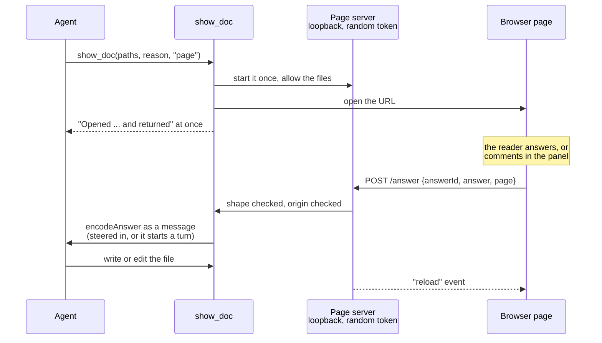

<details>
<summary>The two views</summary>

| View | Opens |
|---|---|
| `page` | The default browser (`open`, `xdg-open`, on Windows `rundll32 url.dll,FileProtocolHandler` from `%SystemRoot%`), one tab per page, on a loopback page server behind a random token. `.md` renders with its blocks; `.html`, `.tsx`, `.jsx` run in a sandboxed frame; images show as they are. |
| `edit` (default) | A text file in your editor: `PI_BETTER_SHOW_EDITOR` (a command line, for example `code -r` or `subl`), else `code`, else `open -t` / `xdg-open` / Notepad on Windows (where `code` counts only as `code.exe`: VS Code's `code.cmd` needs a shell, so name `Code.exe` by its full path in `PI_BETTER_SHOW_EDITOR`; backslashes there are literal). It must return at once; terminal editors do not work. |

A page whose tab you closed opens again when the agent shows it again. `view: "page"` with a file that is not Markdown, React, HTML, or an image is refused, and a binary file is refused for either view.

</details>

### Block problems

`show_doc` tells the agent what is wrong with the blocks of a document, so a block that will not parse is fixed in the next turn.

<details>
<summary>What is checked, and where it is reported</summary>

`show_doc` appends the problems of each Markdown document it opens (`checkBlocks`, see [Core API](#check)) after its usual reply, and the `write` and `edit` tools of the agent get them in their own result for a `.md` file that holds a block fence: `Block problems in questions.md:` then `- line 40 form question "o5" choice 1 label (warning): ...`. Files without block fences are not read by the checker; the YAML parser and Mermaid load on the first file that needs them. Mermaid is checked in the extension with `beautiful-mermaid`, which validates the diagram type and parses what it draws; it does not catch every syntax slip in a flowchart.

</details>

### Markdown pages

A Markdown page is prose plus blocks: the prose is Markdown with raw HTML left as text, and every block above becomes its element.
A form, pick, chip, checklist, or review reaches the agent as a message: steered into a running turn, or starting a turn when the agent is idle (`encodeAnswer`).

<details>
<summary>The page's limits</summary>

Diagrams are drawn on the server, in the page's colour scheme. Images and links resolve against the page's directory: nothing loads from above it, from a dot file or directory, or from another site. Every response carries a CSP, and the server answers only the loopback host. A POST to `/answer` must come from the page itself (its `Origin`) and carry JSON, and the server names the document, so a page cannot answer as another.

</details>

### Feedback panel

Select a passage to comment on it, or click a node, an edge, or a subgraph title in a flowchart or state diagram (Tab to it, then Enter or Space, from the keyboard).
The panel collects comments and an overall note and sends them in one message; its drafts survive the reload an agent's edit causes.
It is an ordinary `feedback` answer: each quote with its comment, then `Overall: …`.

### Diagram comments

A diagram element is quoted in the diagram's own words, so the agent can find it in the source it wrote.

<!-- Diagram: src/extension/client/diagram-map.ts (diagramMap, namesOf, disambiguated, diagramQuote), src/elements/display.ts (pbs-diagram-target), src/extension/client/page.ts, src/extension/client/feedback.ts (feedbackAnswer), src/core/answer.ts (feedbackText). -->

```mermaid
flowchart LR
  svg["Diagram SVG<br/>from /diagram.svg"] -->|"fetchDiagramMap"| map["Targets: node, edge,<br/>group, with their shapes"]
  map -->|"buttons over the image"| press["Click, or Tab and<br/>Enter or Space"]
  press -->|"pbs-diagram-target"| quote["diagramQuote:<br/>[Diagram 2, type] kind: text"]
  quote --> panel["Feedback panel<br/>one entry per element"]
  panel -->|"Send: quote and comment"| msg["encodeAnswer:<br/>> quote, then the comment"]
```

<details>
<summary>How a quote reads</summary>

A quote names the diagram by its position among the page's diagrams and its type, then the element: `> [Diagram 2, stateDiagram-v2] edge: Paid → Refunded "money back"`, `> [Diagram 1, flowchart] node: Check`, `> [Diagram 1, flowchart] group: Review`. A node is its label (`start` and `end` for a state diagram's `[*]`); an edge is `<from> → <to>`, with the edge's label in double quotes when it has one; a group is the subgraph's title. Mermaid entity codes in a label (`#quot;`, `#35;`) are written as the character. The quote is for a reader, not a grammar to parse.

A quote names one element: only when two elements of a diagram would read alike does it add a suffix, a node or group's id (`node: Check (B)`, `group: One (S1)`), an edge's endpoint ids (`edge: Check → Done (A → C)`), and for edges still alike a number in drawing order (`edge: A → B "retry" #2`). When a state diagram has several `[*]`, each inside a composite state names that state: `node: start (in Active)`, `edge: Busy → end (in Active)`; the outer one stays `start`. It is an ordinary `quote` in the `feedback` answer, so the message has the same shape as one for a selection, and the same element is added to the panel only once. Pages that run in a frame (`.html`, `.tsx`) comment on selected text only. Only flowcharts and state diagrams have targets; other diagram types stay plain images.

</details>

### Agent pages

An agent that needs more than blocks writes a page of its own: `.html`, or `.tsx`/`.jsx`.
Either runs in `<iframe sandbox="allow-scripts allow-forms">` without `allow-same-origin`: no storage, no cookies, and no way to answer on its own.
A `<form action="cgi-bin:pi-answer">` or `piBetterShow.send(fields)` answers through the page around the frame.

<details>
<summary>How an answer leaves the frame</summary>

The server refuses a POST whose Origin is not its own (a frame's is `null`) or that is not JSON, and an event stream not opened from its own page. The frame hands its answer to the page around it by `postMessage`; that page posts it as its own, and the message the agent reads begins `Agent page <name> sent:`, since a page the agent wrote runs its own script and its sends are not a user's click.

The page around the frame carries the same feedback panel as a Markdown page: the frame reports the text the user selects to its parent by `postMessage({source: "pbs-frame", type: "selection", text})` (cut to 2000 characters, accepted only from the page's own frame with origin `null`), the user comments on passages and adds an overall note, and one Send delivers a `feedback` answer named by the HTML `<title>`, else the file name.

A TSX page works the same way. Its default export is a React component, built by esbuild on each load with the React this package ships; `import {PbsBlock, PbsForm, ..., parse, encodeAnswer, send} from "pi-kit"` gives it the wrappers.

</details>

### Edit mode

In edit mode your editor opens the file and the extension watches it; the agent reads the net change, not every save.

<!-- Diagram: src/extension/edit.ts (createEditSession: take, willWrite, release, SETTLE_MS, MAX_DIFF_LINES), src/extension/controller.ts (agentStarting, settleLater, tellHeld, deliver), src/extension/index.ts (before_agent_start, tool_execution_start). -->

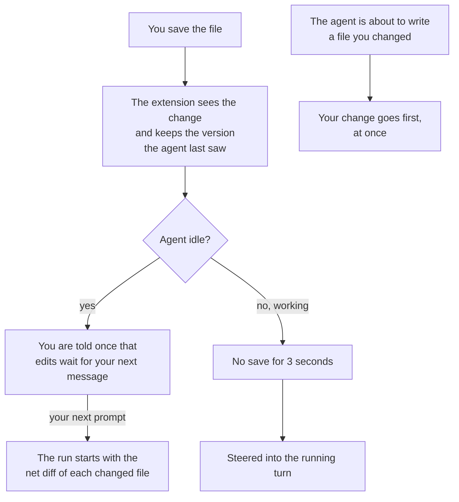

<details>
<summary>What the agent receives, and its limits</summary>

Saves are not sent one by one: the agent gets the net change of each file since the version it last saw, as a zero-context diff (`@@` headers carry line numbers), one message with a section per file. When idle, it is attached to your next message; while the agent works, it is steered in once you stop saving for 3 seconds; before the agent writes a file you changed, your change goes first. Intermediate saves never reach the agent, a change undone before the report sends nothing, and a diff longer than 200 lines is cut with a count of the lines left out. A save in the same instant as the agent's own write is not reported.

The message reads `User edited notes.md:` and then the diff in a `diff` fence. When a shell command ran while you saved, it reads `notes.md changed while a shell command ran; this may include the command's own changes, not only the user's edits:` instead.

</details>

### Live reload and closing

Open tabs follow the file: when the agent edits a shown document (`write`, `edit`, or `bash`), they reload. When you close the last tab, the server stops after 30 seconds, and the next `show_doc` starts a new one and opens its pages again; showing a page whose tab you closed opens it again.

### Mini SDD

When the agent writes a `docs/specs/<slug>/spec.md` whose header says `Status: proposed`, the folder's `decision.md`, `spec.md`, `design.md`, and `verification.md` open as pages on their own (only when pi has a UI); a phase file written later joins. `PI_BETTER_SHOW_AUTO_OPEN=off` stops it.

### Event bus

Other viewers (the pi-straw-boss GUI) read the same documents through `pi.events`, so the contract is versioned: every payload carries `version: 2`.

<details>
<summary>The four events</summary>

| Event | Payload |
|---|---|
| `better-show:documents` | `{version, documents}` in full on every change (a document shown, changed by the agent or saved by you, a page closed) and `[]` when the session ends. Each entry is `{id, kind: "blocks" \| "html" \| "text", display, reason, revision, onScreen, capability?, assets?}`. There is no path: `display` is relative to the working directory, else a `~` path, else the base name. While the page server runs, `capability` is, for a document on screen or open in the editor, the URL that serves the document (Markdown text for `blocks` and `text`; the page as a frame loads it, to be shown in an iframe with `sandbox="allow-scripts allow-forms"`, for `html`) and `assets` the directory URL its relative references resolve against. The list keeps the 32 most recent documents. |
| `better-show:documents-request` | `{version}` asks for the list again; it is sent once on `better-show:documents`. Another `version`, or a request after the session ended, is ignored. |
| `better-show:answer` | `{version, id, answerId, answer}` with `answer` an `Answer`. It reaches the agent as the same message a page answer produces. |
| `better-show:answer-result` | `{version, id, answerId, accepted, reason?}`; `reason` is `closed`, `invalid` (wrong version or shape, or a `text` document), `empty`, or a delivery error. A repeated `answerId` gets its first result back and delivers nothing again. A payload without a string `id` and `answerId` gets no reply. |

A viewer that shows an `html` document in a frame receives its answers as `postMessage({source: "pbs-frame", type: "answer", answerId, answer})` from the frame (origin `"null"`) and replies `{source: "pbs-host", type: "answer-result", answerId, accepted, reason?}`. It also receives `{source: "pbs-frame", type: "selection", text, top?, left?}` whenever the user's selection in the frame changes (`text` is empty when it was cleared) and may offer its own feedback panel with it.

</details>

### Moving from pi-herdr-doc-review

Uninstall it and install this package; `show_doc` keeps its name and parameters. Gone: Herdr panes, nvim and vim, Chawan and terminal-browser, and the `<pi-*>` page-kit tags (write `form`, `review`, ... blocks instead, or use the `pbs-*` elements). The event names changed from `doc-review:*` (version 1) to `better-show:*` (version 2).

Try it without pi: `bun run show` starts the page server on `examples/` with a fake pi that prints each message the agent would receive.
