# pi-better-show 參考 <!-- source: docs/reference.md @ ff1d1b9 -->

[README](../README.zh-TW.md) 背後的完整契約：每一種區塊、core、server、元素與 React 的 API，以及 `show_doc` extension 的細節。請找到需要的那一節，其餘可以略過。

pi-better-show 是一套區塊詞彙：每個負責繪製它的宿主，共用同一個剖析器、同一套純文字備援和同一種答案編碼。pi extension 是這樣的宿主之一，GUI 或聊天橋接也可以是另一個。

```text
pi-better-show            core: isomorphic, no DOM, no node APIs; depends on `yaml` only
pi-better-show/elements   browser: framework-free custom elements, one per block kind (no yaml, no node APIs)
pi-better-show/react      thin React wrappers over the elements (React is an optional peer)
pi-better-show/server     node: Mermaid to SVG and to Unicode text (beautiful-mermaid)
pi-better-show/extension  the pi extension: `show_doc`, a loopback page server, edit mode, event-bus contract v2
```

| 進入點 | 作用 | 章節 |
| --- | --- | --- |
| `pi-better-show` | 把 Markdown 剖析成區塊、寫成純文字、編碼並驗證答案。 | [區塊](#blocks)、[Core API](#core-api) |
| `pi-better-show/server` | 把 Mermaid 畫成 SVG 或 Unicode 文字。 | [Server API](#server-api) |
| `pi-better-show/elements` | 把每種區塊畫成自訂元素，並觸發 `pbs-answer`。 | [元素](#elements) |
| `pi-better-show/react` | 為 React 包裝這些元素。 | [React](#react) |
| `pi-better-show/extension` | `show_doc` 工具、頁面伺服器、編輯模式與事件匯流排。 | [pi extension](#the-pi-extension) |

這個套件發布的是 TypeScript 原始碼，沒有建置步驟。原始碼只用可抹除的語法，所以能在 node 的型別剝除、bun 與打包工具的流程中載入。設計文件：`docs/specs/2026-11-07-better-show/spec.md`。

## 區塊

區塊是 agent 寫下的資料，不是標記：它指出要顯示什麼，由宿主負責繪製，所以 agent 不必寫版面、樣式，或把答案送回去的腳本。
區塊是第一個字為種類名稱的 fenced code block，或是 GitHub alert；fence 可以用反引號或波浪號。多數種類吃 YAML。文字欄位（`body`、`hint`、`note`、...）吃受限的行內 Markdown：粗體、斜體、程式碼、`http(s)` 連結與換行。任何地方都不接受原始 HTML。

<details>
<summary>所有種類一覽</summary>

| 種類 | 寫法 | 答案種類 |
|---|---|---|
| `alert` | `> [!NOTE\|TIP\|IMPORTANT\|WARNING\|CAUTION] title` 引用 | |
| `mermaid` | Mermaid 原始碼 | |
| `diff` | unified diff | |
| `cards` | `{title, tone, body}` 的 YAML 清單 | |
| `options` | `{title, recommended, body, pros, cons}` 的 YAML 清單 | `pick` |
| `form` | YAML `{title, submit, questions: [{name, label, type, hint, required, other, choices}]}` | `form` |
| `review` | YAML `{title, submit, pick, columns, items: [{name, label, image, page, height, body}]}` | `review` |
| `mindmap` | 縮排的 Markdown 清單；第一項是根 | |
| `suggest` | 字串或 `{label, text}` 的 YAML 清單 | `suggest` |
| `checklist` | YAML `{title, submit, items: [string \| {name, label, checked, note}]}` | `checklist` |
| `table` | YAML `{columns, rows, sort, filter}` | |
| `steps` | YAML `{items: [{title, status: done\|doing\|todo\|blocked, when, body}]}` | |
| `stats` | `{label, value, delta, tone, note}` 的 YAML 清單 | |
| `tree` | 縮排的行（每層兩個空格，第一行是根）：資料夾寫 `name/`，後面接 `{tags}` 與 ` # note` | |

</details>

四個範例頁面，每頁混合了多種區塊：

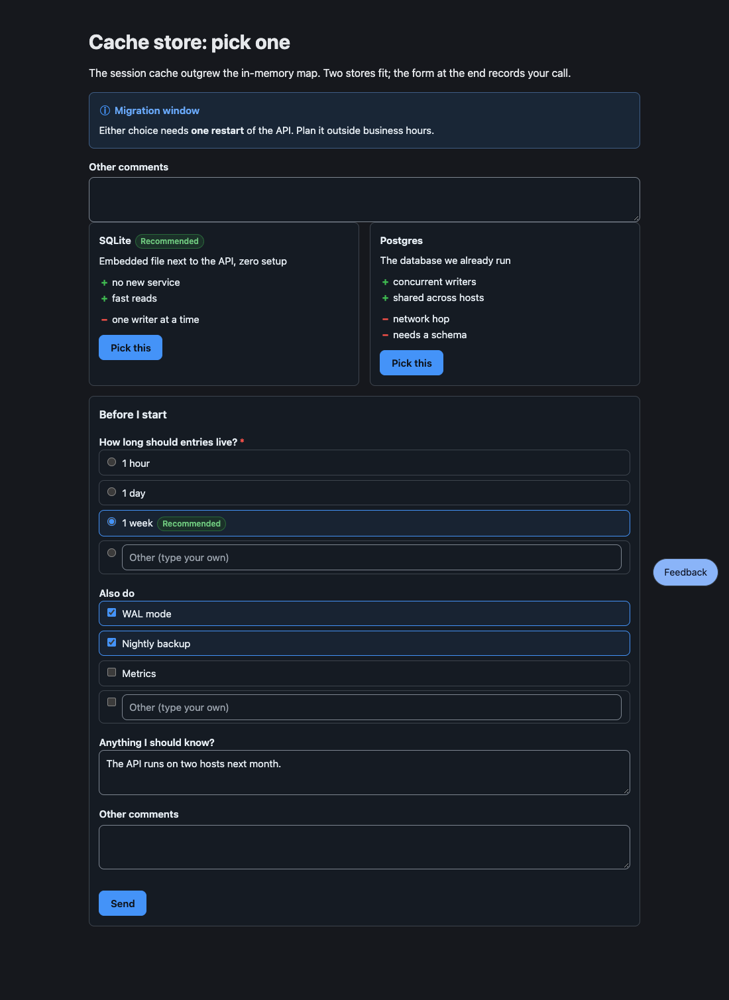

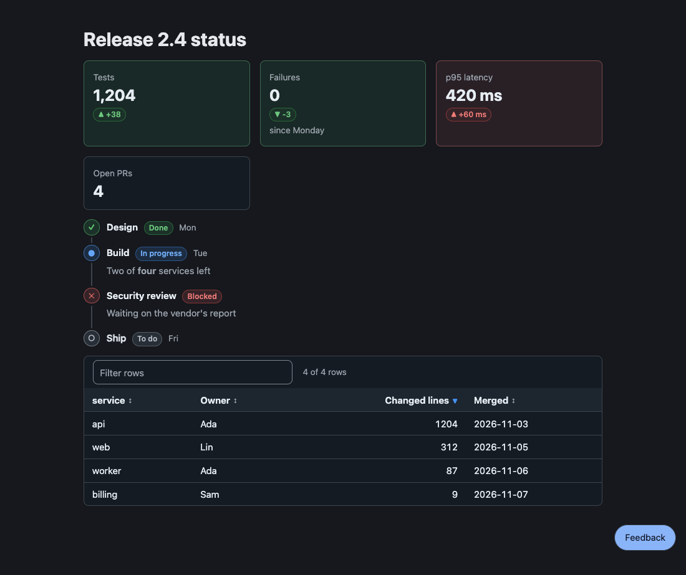

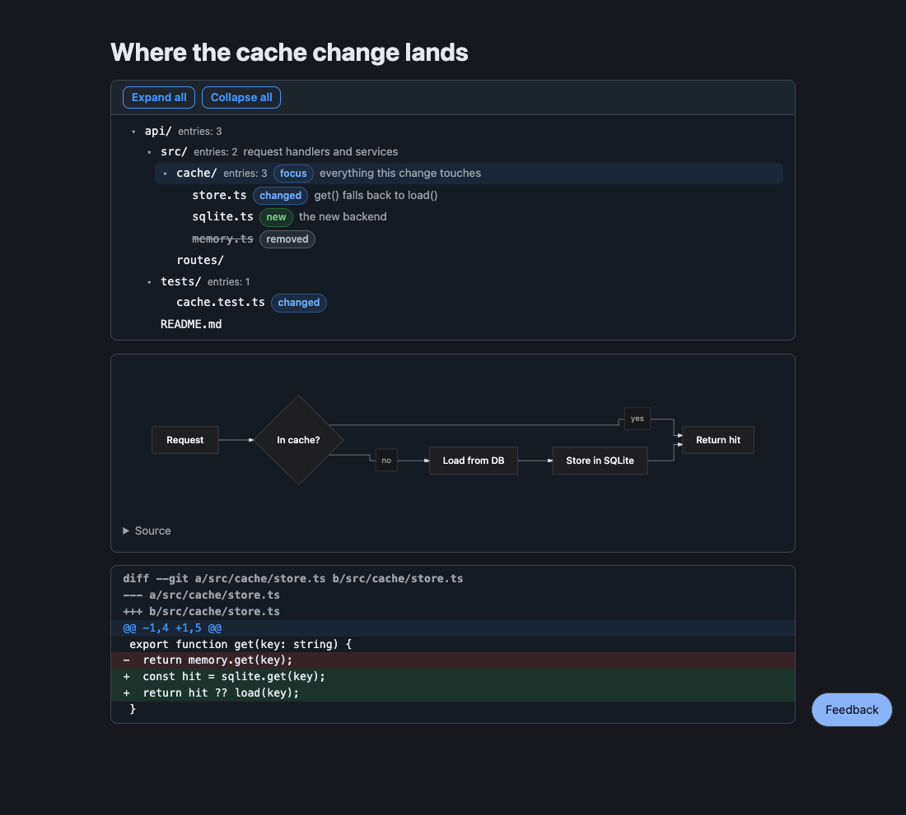

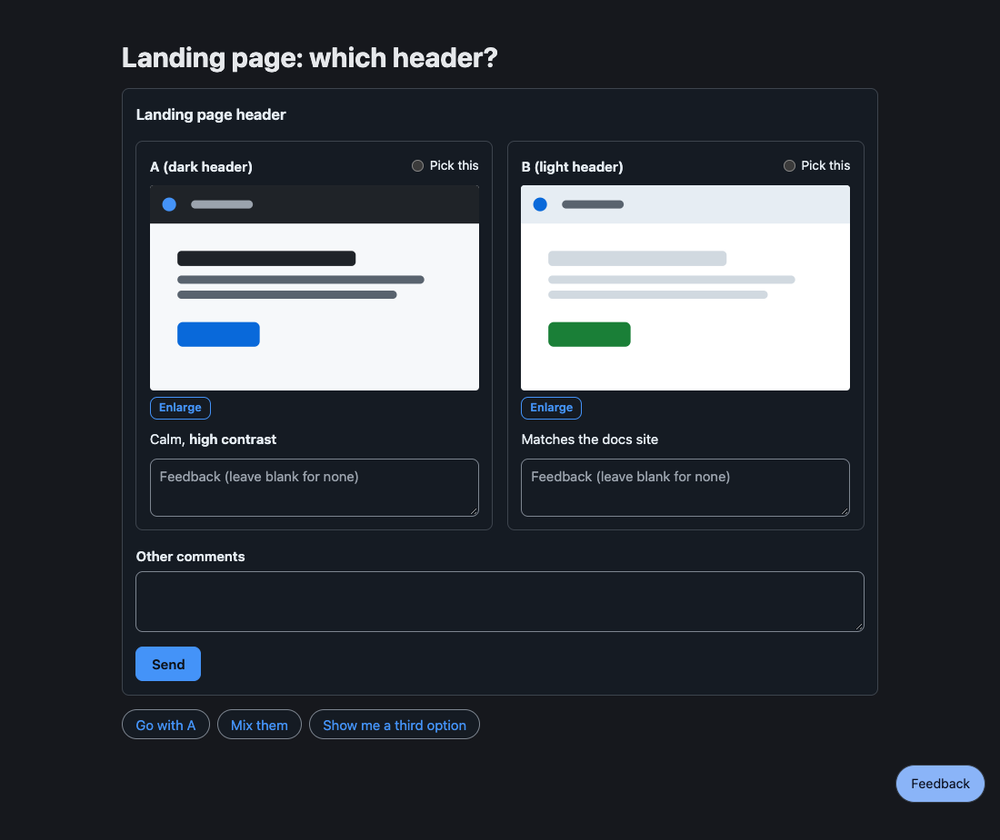

無法剖析的區塊會變成保留原始碼與原因的 `invalid` 片段；不會拋出錯誤，頁面會顯示原始碼與原因。

### Alert

提醒讀者不可錯過的事：一個 GitHub alert，就像 README 裡那樣。

~~~markdown
> [!WARNING] Heads up
> This **overwrites** the cache, see [the runbook](https://example.com/runbook).
~~~

種類有 `NOTE`、`TIP`、`IMPORTANT`、`WARNING` 與 `CAUTION`；標記後面的文字是標題，沒有的話標題就是種類的名稱。內文是跨多行的行內 Markdown。它不接受答案。

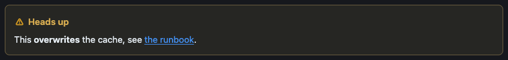

### Cards

並排的簡短方塊，每個有一種語氣（`note`、`ok`、`warn`、`risk`），以色調、徽章與圖示呈現，不會用有顏色的邊。

~~~markdown
```cards
- {title: Speed, tone: ok, body: "**2x** faster than the old path"}
- {title: Risk, tone: warn, body: "Needs a migration window"}
```
~~~

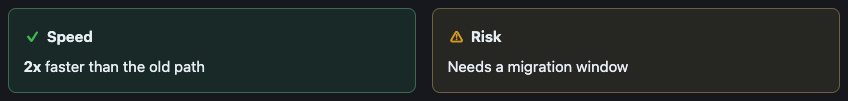

它不接受答案。

### Options

並排的選項，附優缺點；使用者挑一個，挑選就是答案。

~~~markdown
```options
- title: SQLite
  recommended: true
  body: Embedded, zero setup
  pros: [simple, fast]
  cons: [single writer]
- title: Postgres
  body: A server to run
  pros: [concurrent writers]
  cons: [more to operate, needs backups]
```
~~~

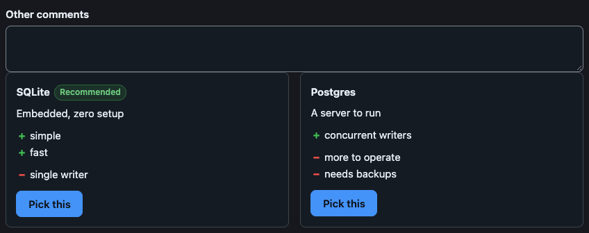

使用者一挑，agent 就收到（元素隨後自行鎖定）：

```text
User picked "SQLite".
```

<details>
<summary>欄位與細節</summary>

- `title` 與 `body` 吃行內 Markdown；`recommended` 是 `true`（徽章寫「Recommended」）或你自己的標籤；`pros` 與 `cons` 是字串清單。
- 答案以選項的純文字標題稱呼它，沒有標題就用編號（第一個是 1）。
- 挑選會立刻送出，所以沒有 Send 按鈕。選項上方的「Other comments」欄位在挑選時一併讀取（見 [Other comments](#other-comments)）。

</details>

### Form

一次回答多個問題：單選、多選或自由文字。Send 會把所有答案放在同一則訊息送出。

~~~markdown
```form
title: Before I start
submit: Send
questions:
  - name: ttl
    label: How long should entries live?
    required: true
    choices: [1 hour, 1 day, {value: week, label: 1 week, recommended: true}]
  - name: extras
    label: Also do
    type: multi
    choices: [WAL mode, Nightly backup, Metrics]
  - name: note
    label: Anything I should know?
```
~~~

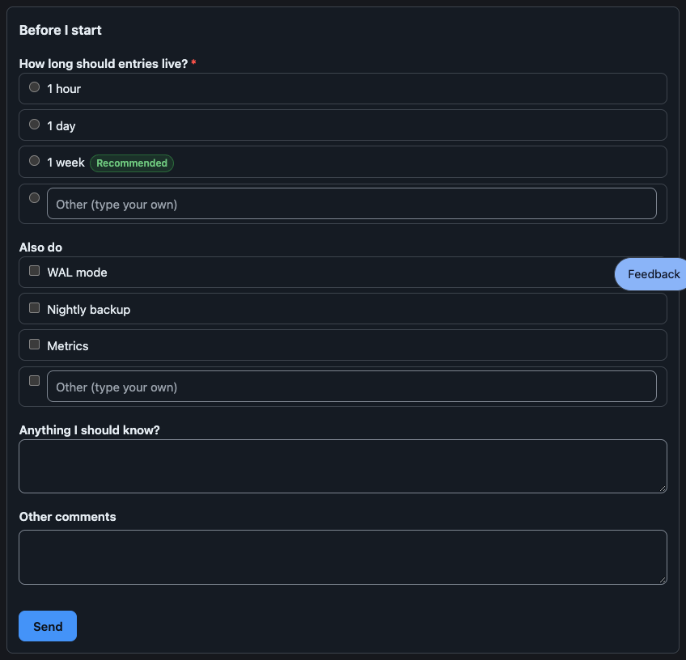

agent 收到：

```text
User submitted a form in the HTML review pane:
- ttl: week
- extras: WAL mode, Nightly backup
- note: The API runs on two hosts next month.
```

<details>
<summary>欄位與細節</summary>

- 問題有 `name`（答案裡的鍵；預設為 label）、`label`、選填的 `hint` 與 `required`。它的 `type` 是 `single`（有 `choices` 時的預設）、`multi` 或 `text`（沒有 `choices` 時的預設）。
- `choices` 的一項是字串，或 `{value, label, note, recommended}`。
- `other` 加一個讓使用者自己作答的欄位：可以是欄位的標籤，或用 `false` 移除。選擇題預設以這樣的欄位結尾，除非寫 `other: false`。
- 必填的問題要答完才能 Send。留空的問題會以 `(no answer)` 送出。
- 表單送出後仍可編輯，所以使用者可以再送一份修改過的答案。

</details>

### Review

要比較的設計、截圖或原型：使用者對每一項留言，設了 `pick` 時還能挑出最喜歡的。

~~~markdown
```review
title: Landing page
pick: true
columns: 2
items:
  - {name: A, label: dark header, image: a.svg, body: "Calm, **high contrast**"}
  - {name: B, label: light header, image: b.svg}
```
~~~

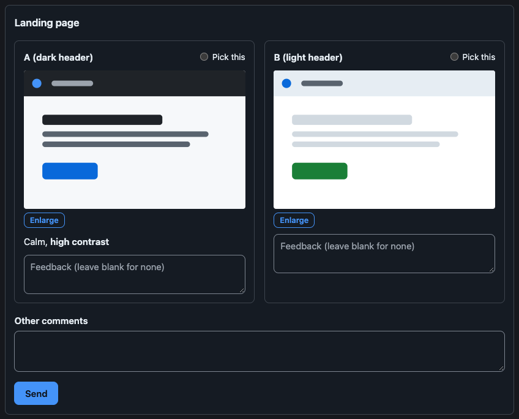

agent 收到挑選的項目、每個有留言的項目與留言，以及留白的項目：

```text
User reviewed "Landing page":
Picked: A (dark header)
- A (dark header): The contrast is right.
No feedback on: B (light header)
```

<details>
<summary>欄位與細節</summary>

- `image` 是相對於 Markdown 檔的路徑（一個項目也可以只寫這個路徑）；`page` 是 HTML 原型的路徑，在高 `height` 像素的沙箱 frame 中顯示。兩者都不能離開頁面所在的目錄。
- 項目依序叫 A、B、C...，除非 `name` 另有指定；答案寫成 `name (label)`。
- `pick: true` 讓每個項目有一個單選鈕（填字串則設定它的標籤）；`columns` 是 1 到 6。
- 留言欄留白代表沒有意見，所以每個欄位都留白的 review 仍然是一份答案。
- 圖片可以在燈箱中放大。

</details>

### Mindmap

可收合的大綱：縮排的 Markdown 清單，第一項是根。

~~~markdown
```mindmap
- Release
  - Build
    - bundle
    - sign
  - Ship
    - tag
```
~~~

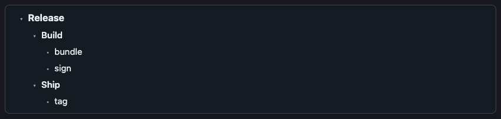

mindmap 只有一個根；其他最上層的項目要縮排到根底下。它不接受答案。方向鍵移動，右鍵與左鍵展開與收合，Enter 與空白鍵切換。

### Suggest

快速回覆的 chip：點一下，就把它的文字當成使用者自己的訊息送出。

~~~markdown
```suggest
- Go ahead
- {label: Not now, text: "Not now, ask me tomorrow"}
```
~~~


agent 收到 chip 的文字本身：`Not now, ask me tomorrow`。字串形式的 chip，label 與 text 相同。

### Checklist

要勾選的項目；勾與沒勾的項目會一起送回。

~~~markdown
```checklist
title: Before release
items:
  - {label: Run tests, checked: true}
  - {label: Bump version, note: semver}
```
~~~

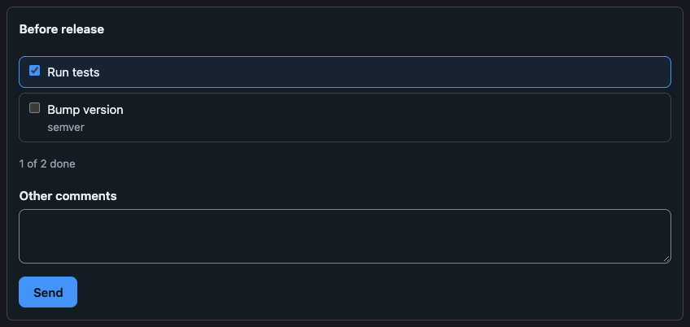

agent 收到：

```text
User updated the checklist "Before release":
☑ Run tests
☐ Bump version
```

項目是字串或 `{name, label, checked, note}`；答案用 `name` 稱呼它，預設為它的 label。

### Table

可排序、可篩選的資料列。

~~~markdown
```table
columns:
  - name
  - {name: size, label: Size, type: number}
  - {name: day, label: Shipped, type: date}
rows:
  - [alpha, 1204, 2026-03-01]
  - [beta, 2, 2026-01-15]
sort: -size
filter: true
```
~~~

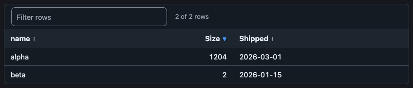

它不接受答案。欄位是名稱或 `{name, label, align, type: text|number|date}`；一列是依欄位順序的清單，或以欄位名稱為鍵的 map。`sort` 指定一欄，前面加 `-` 表示遞減；`filter: true` 加上搜尋欄。

### Steps

每個步驟附狀態的時間軸。

~~~markdown
```steps
items:
  - {title: Design, status: done, when: Mon}
  - {title: Build, status: doing, when: Tue, body: "Two of **four** services left"}
  - {title: Legal review, status: blocked, body: Waiting on the vendor}
  - {title: Ship, status: todo}
```
~~~

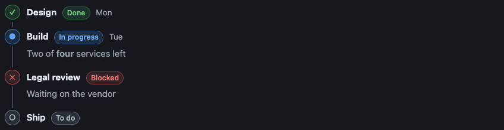

它不接受答案。`status` 是 `done`、`doing`、`todo` 或 `blocked`。

### Stats

帶有選填變化量與語氣的指標方塊。

~~~markdown
```stats
- {label: Users, value: "1,204", delta: "+4%", tone: ok}
- {label: Latency p95, value: 420 ms, delta: "+60 ms", tone: risk}
```
~~~

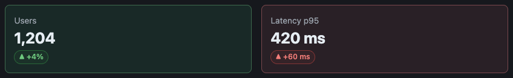

它不接受答案。

### Diff

上色的 unified diff。

~~~markdown
```diff
@@ -1,4 +1,5 @@
 export function get(key: string) {
-  return store.get(key);
+  const hit = store.get(key);
+  return hit ?? load(key);
 }
```
~~~

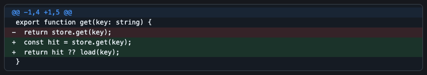

它不接受答案。

### Mermaid

一張圖，在伺服器上依頁面的配色畫出。流程圖與狀態圖可以逐個節點留言（見 [Markdown 頁面](#markdown-pages)）。

~~~markdown
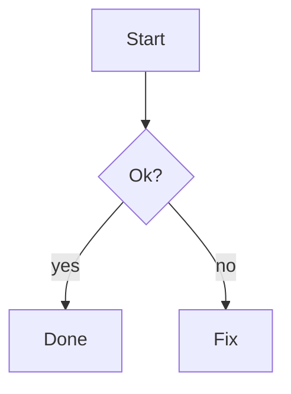
~~~

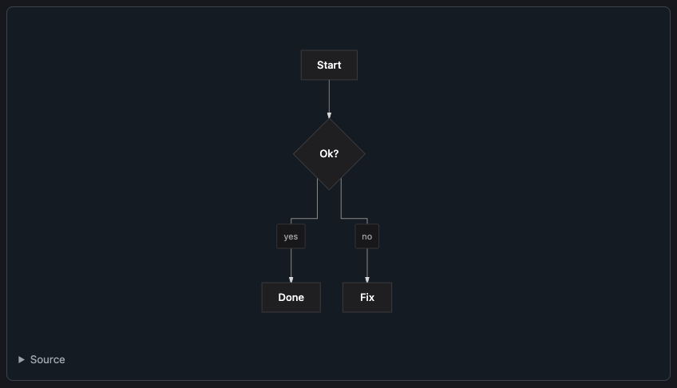

它本身不接受答案。流程圖、狀態圖、sequence、class、ER 與 xychart 都能畫；流程與概念圖請用流程圖。

### Tree

給結構審查用的目錄樹，資料夾可以收合與展開：

```tree
pi-better-show/
  src/ # one package, four entries
    core/ {focus} # parser and text, no DOM
      parse.ts
      validate.ts {new} # checks answers
    elements/ # web components
  tests/
  README.md {changed}
```

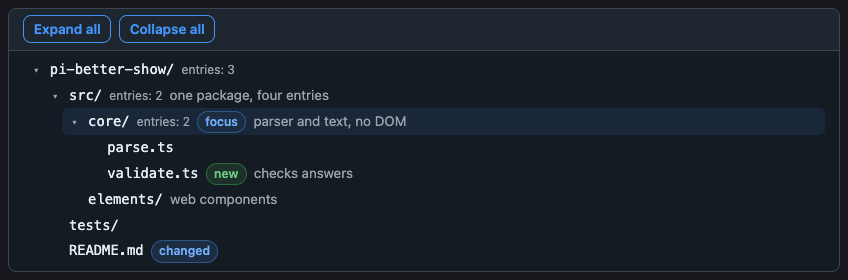

資料夾的名稱以 `/` 結尾；標籤有 `new`、`changed`、`removed`、`focus`、`risk`（不認得的標籤會讓區塊無效）；` # ` 後面的備註吃行內 Markdown；`… N more` 這一行代表被上限截掉的項目。它不接受答案。

<details>
<summary>上限與備援</summary>

樹最多 2,000 個節點、32 層（根是第 1 層）。區塊帶著一份快照，所以每個宿主都能畫；`toText` 以 `tree` 風格（`├──`、`└──`，標籤寫成 `[new]`，備註接在 ` — ` 後面）寫出，在 Discord 上放進 fence。

</details>

### pbs-tree

`pbs-tree` 為一個資料夾印出 `tree` fence：`npx pbs-tree [dir]` 或 `bunx pbs-tree [dir]`（只用 node 內建模組的純 JavaScript；node 與 bun 都能跑）。輸出依名稱的位元組順序排序，所以快照可重現；不會跟隨 symlink。旗標在有對應時沿用 Linux 的 `tree`：

| 旗標 | 意義 |
|---|---|
| `-L n` | 深度 |
| `-d` | 只列資料夾 |
| `-a` | 包含點開頭的檔案（預設略過；`.git` 一律略過） |
| `-I pattern` | 略過符合 glob（`*` `?` `[..]`）的名稱；`\|` 分隔多個；可重複 |
| `-P pattern` | 只列符合的檔案；資料夾含有符合項目就保留（即使低於 `-L` 的深度）；搭配 `-d` 時忽略 |
| `--gitignore` | 遵守 `.gitignore` 檔，包括該資料夾與往上到儲存庫頂層的各層資料夾的 |
| `--dirsfirst` | 資料夾排在檔案前面 |
| `--filelimit n` | 不展開含有超過 n 個項目的資料夾；在原處寫 `… N more` |
| `--prune` | 去掉空的資料夾（被 `-L` 隱藏的仍然算數）；搭配 `-d` 時忽略 |
| `--changed-since <rev>` | 依工作樹對 `git diff --name-status <rev>` 的結果標 `new`、`changed`、`removed`；已移除的檔案雖不存在仍會列出，未追蹤的檔案是 `new`，改名視為一個移除加一個新增 |

<details>
<summary>上限與結束碼</summary>

超過區塊上限的樹會被拒絕（結束碼 1）並附上節點數；請用 `-L`、`-I`、`--gitignore` 縮小。會被讀成備註或標籤的名稱會加上不換行空白，名稱裡的換行會變成 `?`。結束碼：0；1 表示失敗（不是資料夾、git 失敗、太大）；2 表示旗標有誤。

</details>

### Other comments

每個可送出的元素（`pbs-form`、`pbs-review`、`pbs-checklist`、`pbs-options`）在送出鈕上方都有一個固定的「Other comments」欄位（`pbs-options` 則在選項上方；欄位在挑選選項時一併讀取）。去除前後空白的文字會放進同一份答案的保留欄位 `pi-note`（`NOTE_FIELD`），只出現一次，欄位留白就什麼都不送；agent 讀到的是最後一行 `Other comments: …`。

<details>
<summary>給宿主</summary>

`validateAnswer` 對每一種互動種類都接受 `pi-note`；表單問題或 checklist 項目不能取名 `pi-note`。顯示這些元素的宿主不必另外做什麼：欄位就在 `answer.fields` 裡，所以 `validateAnswer` 與 `encodeAnswer` 本來就會放行。從選出的欄位重建答案的宿主必須轉送 `pi-note`；把 `answered` 設成已送出的欄位，鎖定後的元素才會顯示它。文字是 `configure({strings})` 裡的 `otherComments`。

</details>

### Several values

收集多個值的區塊（含 `multi` 問題的 `form`、`checklist`、`review`）在勾選、挑選或輸入時不會送出任何東西：選擇在使用者按下 Send 之前都可以更改，必填的 `multi` 問題一個都沒選，會在該題被拒絕。只有 `options` 與 `suggest` 在點擊時就送出。

## Core API

Core 是不需要畫面的完整詞彙：它把 Markdown 剖析成片段、寫成純文字，並編碼使用者給的答案。它不碰 DOM 也不碰 node API，所以只要有 JavaScript 的地方都能跑。

```ts
import { parse, toText, inline, encodeAnswer, checkBlocks } from "pi-better-show";
```

### Parse

```ts
parse(markdown: string): Segment[]
```

依序把文件切成 `{type: "markdown", text}`、`{type: "block", kind, data, index}` 與 `{type: "invalid", kind, source, error}` 片段。`data` 依種類有型別（`BlockDataMap`）。`index` 從 0 開始，數文件中每一種區塊；無效的區塊不佔編號。`index` 就是答案用來定位區塊的位址。

### Check

告訴作者一個檔案的區塊哪裡有問題，而 `parse` 只會繼續往下剖析。

```ts
checkBlocks(markdown: string, options?: { mermaid?: (source: string) => string | undefined }): BlockProblem[]
formatProblems(name: string, problems: BlockProblem[]): string

interface BlockProblem {
  kind: BlockKind;
  line: number;                      // 1-based, in the Markdown file
  path: string;                      // e.g. form question "o5" choice 1 label
  message: string;
  severity: "error" | "warning";
}
```

<details>
<summary>哪些是 error，哪些是 warning</summary>

`error`：區塊無效，頁面會顯示它的原始碼（YAML 錯誤會回報在造成它的那一行；被沒加引號的 ` #` 弄斷的 flow collection，會指向開啟它的那一行）。`warning`：區塊畫得出來，但寫下的內容有一部分遺失：被 ` #` 截短的純值（YAML 把後面讀成註解；訊息會指出鍵的路徑並提醒加引號）、區塊在那一層不讀的鍵（附上已知的鍵，差一點打對時還有「你是不是要寫」的提示），或是一直沒有關閉的 fence。Core 沒有 Mermaid 剖析器：傳入 `options.mermaid`（回傳圖的原始碼哪裡有問題），也能檢查圖。它是純函式，載入的東西不比 `parse` 多。

</details>

### Text fallback

為無法畫區塊的介面轉譯文件：Discord、LINE、終端機。

```ts
toText(segments: Segment[], profile: TextProfile): string

interface TextProfile {
  flavor: "discord" | "line" | "plain";   // Discord Markdown, or plain text
  width?: number;                          // columns a diagram may take; default 60
  mermaid?: (source: string, width: number) => string | undefined;
  keep?: readonly BlockKind[];             // kinds emitted as their `raw` text instead of converted
  lang?: "en" | "zh-TW";                   // language of the reply instructions; default "en", anything else is "en"
}
```

<details>
<summary>回覆指示、`raw` 與圖的 hook</summary>

互動種類（`options`、`form`、`review`、`suggest` 與 `checklist`）以一行回覆指示收尾：「Reply with a number.」、「Reply in text, one line per question, like `1: b`.」等等。`lang: "zh-TW"` 會以繁體中文寫出；知道對話語言時請傳入。區塊的內容絕不翻譯。

每個 `BlockSegment` 與 `InvalidSegment` 都帶 `raw`：區塊一字不差的原文，包含 fence（或 alert 整段 `>` 引用）。列在 `keep` 的種類，不論有效或無效，都以 `raw` 原樣輸出，給自己會畫它們的介面；其他種類照常轉換。`DISPLAY_KINDS`（`alert`、`cards`、`mermaid`、`mindmap`、`diff`、`table`、`steps`、`stats`、`tree`）是這類介面常用的 `keep` 清單；`INTERACTIVE_KINDS`（`options`、`suggest`、`form`、`checklist`、`review`）是使用者會作答的種類，無法畫出它們的介面會拿到回覆指示。沒有 `keep` 時，輸出不變。

為無法畫區塊的介面轉譯文件。圖會經過 `mermaid` hook；沒有 hook、或它回傳 `undefined` 或比 `width` 更寬的圖時，輸出是程式碼區塊中的 Mermaid 原始碼，加上指向網頁版的提示。輸出裡不會留下任何區塊種類的 fence，Discord 原生的 `diff` 除外。

</details>

### Answers

答案是一個種類加上一串 `[name, value]` 欄位；`encodeAnswer` 把它變成 agent 讀的文字。

```ts
inline(text: string): InlineToken[]      // restricted inline Markdown, tokenized, never HTML
inlinePlain(text: string): string        // the same text without markers
displayWidth(text: string): number       // terminal columns: CJK counts 2
reviewItemName(item): string             // "B (dark header)"

interface Answer {
  kind: "form" | "review" | "feedback" | "pick" | "suggest" | "checklist";
  title?: string;
  fields: [name: string, value: string][];
  ref?: { doc?: string; block: number };
}
encodeAnswer(answer: Answer): string
```

`encodeAnswer` 產生 agent 讀的文字。對 `form`、`review` 與 `feedback`，給同樣的欄位時，它與 pi-herdr-doc-review 的 `formMessage`、`reviewMessage` 與 `pageFeedbackMessage` 位元組相容（舊的 `pi-kind` 欄位會被忽略）。`ref` 是給宿主定位區塊用的，不會出現在文字裡。`pi-note` 欄位（見下）會以 `Other comments: …` 附在後面。

| 種類 | `fields` | 文字 |
|---|---|---|
| `form` | 每個問題一個 `[name, value]` | `User submitted a form ...` 後面接 `- name: value` 各行 |
| `review` | `title`、`picked`、成對的 `item`/`comment`、`silent` | `User reviewed "title":` ... |
| `feedback` | `page`、成對的 `quote`/`comment`、`overall` | `User feedback on the page "page":` ...（quote 是選取的段落，或圖上的元素，見 Markdown 頁面） |
| `pick` | `[["picked", option]]` | `User picked "option" for "title".` |
| `suggest` | `[["text", text]]` | 文字本身 |
| `checklist` | 每個項目一個 `[name, "checked" \| "unchecked"]` | `User updated the checklist "title":` 後面接 `☑`/`☐` 各行 |

### Validate answers

給從不受信任的用戶端收到 `Answer` 的宿主：`validateAnswer` 判斷它是否符合所稱要回答的區塊。

```ts
validateAnswer(block: BlockSegment, answer: Answer): { ok: true } | { ok: false; reason: string }
```

<details>
<summary>接受什麼</summary>

`validateAnswer` 是給從不受信任的用戶端收到 `Answer` 的宿主用的。答案的 `kind` 符合區塊（`options` 收 `pick`，其他收自己的種類）、每個欄位都指名該區塊的問題、選項或項目，且最多 64 個欄位、每個最多 1,024 個字元時，它才接受。同一個名稱的多個值，只有 `multi` 的表單問題才接受（以重複的欄位，或表單元素送出的合併值）；`single` 或 `text` 問題、挑選與建議都只收一個。必填的問題必須有答案（空值或 `(no answer)` 不算答案）。沒有 `other` 欄位的 `form` 問題，值必須是它的選項之一。`checklist` 的欄位是項目名稱各出現一次、加上 `checked` 或 `unchecked`；`review` 只有在區塊有 `pick` 時才能帶 `picked`。被拒絕時 `reason` 會說明原因，給宿主的錯誤回覆用。不接受答案的區塊（顯示用的種類）一律拒絕。

</details>

## Server API

server 進入點為畫不了 Mermaid 的宿主代勞：畫成給頁面用、自成一體的 SVG，或給文字介面用的 Unicode 框線。

```ts
import { mermaidSvg, mermaidText } from "pi-better-show/server";

mermaidSvg(source: string, options?: { scheme?: "light" | "dark" | DiagramColors; font?: string; transparent?: boolean }): string
mermaidText(source: string, width = 60): string | undefined
```

`mermaidSvg` 以 `scheme` 的顏色畫出自成一體的 SVG（請用真正的顏色；圖片 URL 讀不到宿主頁面的 CSS）。它沒有 `@import` 也沒有 `<script>`，遇到畫不了的原始碼會拋出錯誤。`mermaidText` 畫 Unicode 框線，在原始碼無效、某一行比 `width` 寬，或寬字元（CJK、emoji）會讓方框錯位時回傳 `undefined`。它就是 `toText` 的 `mermaid` hook：

```ts
toText(parse(reply), { flavor: "discord", mermaid: mermaidText });
```

## 元素

元素是詞彙在瀏覽器端的一半：每種區塊一個不依賴框架的自訂元素。宿主把剖析好的 `data` 交給每個元素，並監聽一個事件，`pbs-answer`。

### 使用元素

```ts
import "pi-better-show/elements";           // defines every pbs-* tag (a no-op without a DOM)
import { configure } from "pi-better-show/elements";

el.data = segment.data;                      // or <pbs-form data-json='{...}'>
el.addEventListener("pbs-answer", (event) => send(encodeAnswer(event.detail)));
el.answered = event.detail.fields;           // once delivered: locks the element and shows what was sent
```

宿主把區塊剖析後的 `data` 交給元素，並監聽 `pbs-answer`（會冒泡、composed、可取消），它的 `detail` 是 core 的 `Answer`。元素從不讀寫 HTML：文字以文字節點進入頁面，連結只允許 `http(s)`，並帶 `rel="noopener noreferrer"` 與 `target="_blank"`。每個元素是帶 constructed stylesheet（`adoptedStyleSheets`）的 shadow root，所以能在 `default-src 'self'` 下執行：沒有 `<style>` 元素，也沒有 `style` 屬性。`examples/` 就是這樣的頁面；用 `bun run demo` 執行（loopback，連接埠 4177）。

### 標籤

| 標籤 | 區塊 | `data` | 答案 | 部件 |
|---|---|---|---|---|
| `pbs-callout` | `alert` | `AlertData` | | `callout` `header` `icon` `title` `body` |
| `pbs-cards` | `cards` | `CardsData` | | `grid` `card` `title` `icon` `body` |
| `pbs-options` | `options` | `OptionsData` | `pick` | `grid` `option` `title` `badge` `body` `pros` `cons` `actions` `pick` `status` |
| `pbs-form` | `form` | `FormData` | `form` | `form` `title` `question` `label` `hint` `choices` `choice` `badge` `other` `textarea` `error` `actions` `submit` `status` `sent` |
| `pbs-review` | `review` | `ReviewData` | `review` | `review` `title` `items` `item` `item-title` `pick` `media` `image` `enlarge` `frame` `unavailable` `body` `comment` `actions` `submit` `status` `lightbox` `close` `sent` |
| `pbs-mindmap` | `mindmap` | `MindmapData` | | `mindmap` `tree` `item` `node` `toggle` `label` `group` |
| `pbs-suggest` | `suggest` | `SuggestData` | `suggest` | `suggest` `chips` `chip` `status` |
| `pbs-checklist` | `checklist` | `ChecklistData` | `checklist` | `checklist` `title` `items` `item` `progress` `actions` `submit` `status` `sent` |
| `pbs-table` | `table` | `TableData` | | `table` `bar` `filter` `count` `scroll` `header` `head` `sort` `body` `row` `cell` `empty` |
| `pbs-steps` | `steps` | `StepsData` | | `steps` `step` `rail` `marker` `content` `title` `badge` `when` `body` |
| `pbs-stats` | `stats` | `StatsData` | | `grid` `stat` `label` `value` `delta` `note` |
| `pbs-diff` | `diff` | `DiffData` | | `diff` `scroll` `line` |
| `pbs-diagram` | `mermaid` | `MermaidData` | | `diagram` `image` `source` `note` |
| `pbs-tree` | `tree` | `TreeData` | | `treeview` `bar` `expand-all` `collapse-all` `tree` `item` `node` `toggle` `name` `count` `tags` `tag` `note` `more` `group` |

`TAGS` 把區塊種類對應到它的標籤。沒有整份文件的元素：extension 在自己的頁面伺服器上渲染 Markdown，其他宿主用自己的渲染器。

### 屬性與 property

每個元素都有這些。

| 名稱 | 種類 | 意義 |
|---|---|---|
| `data` / `data-json` | property / attribute | 區塊的資料；JSON 有誤或元素畫不了的形狀，會顯示錯誤面板並觸發 `pbs-error`。 |
| `answered` / `data-answered` | property / attribute | 已送出的 `[name, value][]`：鎖定元素並顯示它們。`undefined` 會重新開啟。 |
| `ref`，或 `doc` 與 `block` 屬性 | property / attributes | 區塊的位址，會複製進每份答案的 `ref`。 |
| `density` | attribute 與 property | `comfortable`（預設）或 `compact`。 |
| `scheme` | attribute 與 property | `light` 或 `dark`，用來強制配色；否則元素跟隨宿主的 `color-scheme`。 |
| `lang` | attribute（或祖先的、文件的） | `zh*` 顯示繁體中文，其他顯示英文。 |
| `refresh()` | method | 重新繪製。宿主改變 `color-scheme` 或文件的 `lang` 之後要呼叫它，元素觀察不到這些變化。 |

### 答案

挑選（`pbs-options`）或 chip（`pbs-suggest`）會立刻送出，並在監聽者接下事件後鎖定自己；呼叫 `preventDefault()` 的監聽者會拒絕它，元素維持開啟。表單、review 或 checklist 送出後仍可編輯（狀態列寫「Sent.」），所以使用者可以再送一份修改過的答案；宿主用設定 `answered` 來鎖定它。表單的必填問題在送出前先檢查。在文字框按 Ctrl/Cmd+Enter 即可送出。

### 設定

元素本身不該做的事由宿主負責：圖、review 圖片與原型從哪裡來、用字，以及圖能不能被指點。

```ts
configure({
  strings: { "zh-Hant": { send: "送出" } },            // per locale, per word (see Strings)
  diagramUrl: (source, scheme) => `/diagram.svg?...`,   // an image URL for pbs-diagram; without it the source is shown
  imageUrl: (ref) => `/files/${ref}`,                    // a review item's `image`; default admits http(s) and raster data URLs only
  pageUrl: (ref) => `/pages/${ref}`,                     // a review item's `page`, shown in a sandboxed frame; without it, its name
  diagramMap: async (url) => readTargets(url),           // makes a diagram's nodes and edges clickable (below); without it the diagram is an image
});
```

請從 `pi-better-show/server` 提供圖片（`mermaidSvg(source, { scheme, transparent: true })`）；圖的標記不會進入頁面。`resetConfiguration()` 會還原預設值。

### 指向圖

設了 `diagramMap` 後，圖的節點與邊會變成使用者可以留言的按鈕。

<details>
<summary>宿主要提供什麼</summary>

設了 `diagramMap` 後，`pbs-diagram` 在圖片的每個節點、邊（它的線與標籤框）與 subgraph 標題上蓋一個透明按鈕。`diagramMap(url)` 收到 `diagramUrl` 回傳的 URL，並解析成 `DiagramMap`：`{ viewBox, targets: [{ kind: "node" | "edge" | "group", text, shapes: [{ tag, attrs }] }] }`，形狀用圖片自己的座標，而且只帶幾何屬性。讀取並剖析繪圖的是宿主，因為元素從不剖析標記；extension 的頁面為 `mermaidSvg` 畫的 SVG 做這件事（`g.node`、`.edge`、`g.edge-label`、`g.subgraph` 與它們的 `data-*` 標籤：流程圖與狀態圖；其他圖種沒有目標，維持圖片）。目標依閱讀順序排列，也就是方向鍵走的順序；不論順序如何，群組畫在邊的下面，邊畫在節點的下面。點擊，或在有焦點的按鈕上按 Enter 或空白鍵，會從按鈕本身觸發 `pbs-diagram-target`（冒泡、composed），帶 `detail: { kind, text }`，所以 `composedPath()[0]` 就是宿主要把焦點還回去的地方。整張圖是一個 Tab 停靠點，落在最後取得焦點的按鈕上（一開始是第一個）；方向鍵移到下一個或上一個按鈕，Home 與 End 移到第一個或最後一個。按鈕放在一個 `role="group"` 裡，它的描述（`aria-describedby`，一個 SVG `desc`）告訴螢幕閱讀器用方向鍵在按鈕之間移動；DOM 維持繪製的圖層順序，而不是閱讀順序。每個按鈕都帶 `aria-label`（「Comment on edge: …」），並在滑過與取得焦點時顯示蓋在圖上的色調，所以不會有東西移動。

</details>

### Token

在元素或任何祖先上設定 `--pbs-*` 屬性；每個都有跟隨宿主 `color-scheme` 的 `light-dark()` 預設值。

| Token | 意義 |
|---|---|
| `--pbs-bg` `--pbs-surface` | 面板背景；有底色的表面（表頭、程式碼） |
| `--pbs-fg` `--pbs-muted` | 文字；次要文字 |
| `--pbs-line` `--pbs-control` | 面板與分隔線；輸入框的邊（與其表面 3:1 對比） |
| `--pbs-accent` `--pbs-on-accent` | 按鈕、連結、選取；其上的文字 |
| `--pbs-note` `--pbs-ok` `--pbs-warn` `--pbs-risk` | 語氣 |
| `--pbs-radius` `--pbs-gap` | 圓角；區塊之間與內部的間距 |
| `--pbs-font` `--pbs-mono` `--pbs-font-size` | 字體 |
| `--pbs-font-display` | 標題（預設為 `--pbs-font`） |

結構帶有 `part` 名稱，可用 `::part()` 重新設計樣式。面板四邊的框線相同，或完全沒有；語氣以色調、徽章、圖示與標題顏色呈現，絕不用有顏色或較粗的單邊框線。`examples/demo.css` 把 Roundtable 與 Straw boss 的 token 對應起來當範例。

### 鍵盤

每個控制項都是有標籤的原生控制項。`pbs-mindmap` 遵循 ARIA tree 模式（方向鍵移動，右鍵與左鍵展開與收合，Enter 與空白鍵切換，Home 與 End 跳轉）；`pbs-tree` 也遵循，並把資料夾展開到第 2 層（更深、含有帶標籤節點的資料夾會展開到那條路徑），附「expand all」與「collapse all」按鈕；`pbs-table` 從表頭按鈕排序（`aria-sort`），並從有標籤的搜尋框篩選。

## React

React 進入點是很薄的一層：每個元素一個元件，所以 React 宿主從不直接碰自訂元素。

```tsx
import { PbsBlock, PbsForm } from "pi-better-show/react";

<PbsBlock segment={segment} doc="chat-7" onAnswer={(answer) => send(encodeAnswer(answer))} />
<PbsForm data={formData} answered={fields} density="compact" onAnswer={...} />
```

每個元素一個元件（`PbsCallout` ... `PbsTree`），外加 `PbsBlock`：它用該種類的元素畫出一個 `parse` 片段，並以它的 `index` 定位。Props：`data`、`answered`、`onAnswer(answer, event)`（回傳 `false` 表示拒絕）、`blockRef`、`density`、`scheme`、`lang`、`className`、`id`、`ref`。父元件以相同的 `data` 重新渲染，不會重畫元素，也不會清掉使用者輸入的內容。需要 React 19 或更新版本，作為選用的 peer dependency。

## pi extension

`pi-better-show` 是一個 pi 套件：它加入 `show_doc`，把 agent 的文件顯示在你的預設瀏覽器或編輯器，並把你在那裡做的事當成訊息送回給 agent。它取代 `pi-herdr-doc-review`（同名工具，不需要 Herdr，也沒有終端機 pane）。

```bash
pi uninstall npm:pi-herdr-doc-review     # same tool name: do not load both
pi install npm:pi-better-show
```

接著在執行中的 session 裡 `/reload`。

### 工具

`show_doc({paths, reason, view})` 會立刻回傳，不等你；你在頁面或編輯器裡做的事，之後會以訊息的形式送到 agent。

<!-- Diagram: src/extension/tool.ts (showDocTool), src/extension/controller.ts (show, showPages, ensureServer, decide, deliver), src/extension/server.ts (postAnswer, fromHostPage, sendEvents), src/extension/client/page.ts, src/extension/client/markdown-page.ts (mountPage), src/core/answer.ts (encodeAnswer). -->

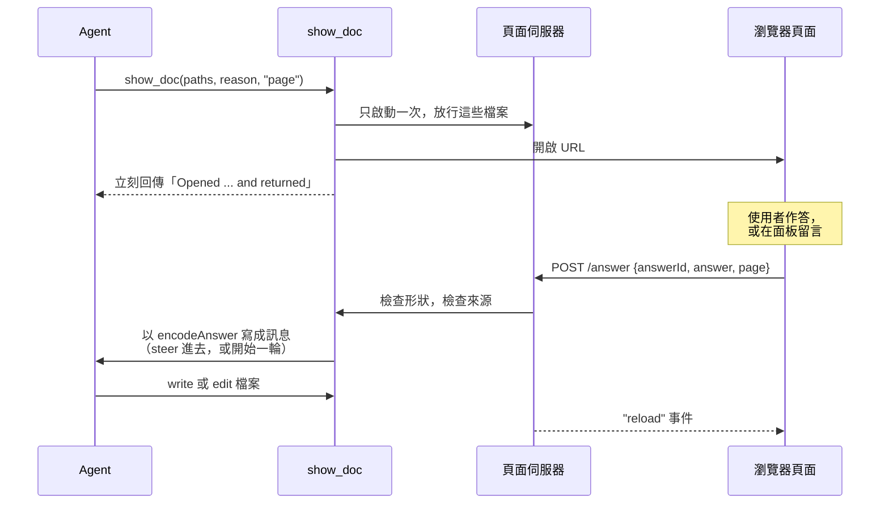

<details>
<summary>兩種檢視</summary>

| 檢視 | 開啟 |
|---|---|
| `page` | 預設瀏覽器（`open`、`xdg-open`，Windows 上是 `%SystemRoot%` 底下的 `rundll32 url.dll,FileProtocolHandler`），一頁一個分頁，在由隨機 token 保護的 loopback 頁面伺服器上。`.md` 連同區塊一起渲染；`.html`、`.tsx`、`.jsx` 在沙箱 frame 中執行；圖片照原樣顯示。 |
| `edit`（預設） | 在你的編輯器開啟文字檔：`PI_BETTER_SHOW_EDITOR`（一行指令，例如 `code -r` 或 `subl`），否則 `code`，再否則 `open -t` / `xdg-open` / Windows 的記事本（Windows 上 `code` 只算 `code.exe`：VS Code 的 `code.cmd` 需要 shell，所以請在 `PI_BETTER_SHOW_EDITOR` 用完整路徑指定 `Code.exe`；那裡的反斜線是字面的）。它必須立刻回傳；終端機編輯器行不通。 |

你關掉分頁的頁面，在 agent 再次顯示它時會重新開啟。`view: "page"` 搭配不是 Markdown、React、HTML 或圖片的檔案會被拒絕，二進位檔在兩種檢視都會被拒絕。

</details>

### 區塊問題

`show_doc` 會告訴 agent 文件的區塊哪裡有問題，所以剖析不了的區塊下一輪就會被修好。

<details>
<summary>檢查什麼、在哪裡回報</summary>

`show_doc` 會把它開啟的每份 Markdown 文件的問題（`checkBlocks`，見 [Core API](#check)）附在平常的回覆後面；agent 的 `write` 與 `edit` 工具，對含有區塊 fence 的 `.md` 檔，也會在自己的結果裡拿到：`Block problems in questions.md:` 接著 `- line 40 form question "o5" choice 1 label (warning): ...`。沒有區塊 fence 的檔案檢查器不會讀；YAML 剖析器與 Mermaid 在第一個需要它們的檔案才載入。Mermaid 在 extension 裡用 `beautiful-mermaid` 檢查，它會驗證圖的種類並剖析它畫得出來的東西；它抓不到流程圖的每一個語法小錯。

</details>

### Markdown 頁面

Markdown 頁面是文章加區塊：文章是 Markdown，原始 HTML 保留為文字，上面的每種區塊都會變成它的元素。
表單、挑選、chip、checklist 或 review 會以訊息的形式送到 agent：steer 進進行中的一輪，agent 閒置時則開始新的一輪（`encodeAnswer`）。

<details>
<summary>頁面的限制</summary>

圖在伺服器上畫，依頁面的配色。圖片與連結依頁面所在的目錄解析：不會從它上層、從點開頭的檔案或目錄，或從其他網站載入任何東西。每個回應都帶 CSP，伺服器只回應 loopback 主機。對 `/answer` 的 POST 必須來自頁面本身（看它的 `Origin`）且帶 JSON，並由伺服器指明是哪份文件，所以頁面不能冒充別人作答。

</details>

### 意見面板

選取一段文字就能留言，也可以在流程圖或狀態圖裡點節點、邊或 subgraph 標題（用鍵盤時 Tab 到這張圖，用方向鍵移到元素，再按 Enter 或空白鍵；在面板裡按 Escape 會回到它，除非這個 Escape 是在結束輸入法的組字）。
面板會收集留言與整體意見，在一則訊息中送出；它的草稿能撐過 agent 修改造成的重新載入。
它是一般的 `feedback` 答案：每則 quote 加上它的留言，最後是 `Overall: …`。

### 圖的留言

圖上的元素會以圖自己的用語被引用，agent 才能在它寫的原始碼中找到它。

<!-- Diagram: src/extension/client/diagram-map.ts (diagramMap, settle, disambiguated, inReadingOrder, diagramQuote, diagramRef, requoteDiagram), src/elements/display.ts (pbs-diagram-target), src/extension/client/markdown-page.ts (mountPage), src/extension/client/feedback.ts (feedbackAnswer, requote), src/core/answer.ts (feedbackText). -->

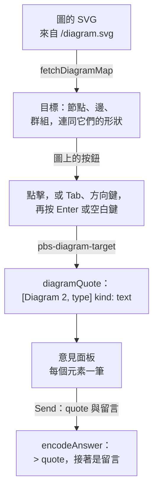

<details>
<summary>quote 怎麼讀</summary>

quote 以圖在頁面所有圖中的位置與它的種類稱呼這張圖，再接元素：`> [Diagram 2, stateDiagram-v2] edge: Paid → Refunded "money back"`、`> [Diagram 1, flowchart] node: Check`、`> [Diagram 1, flowchart] group: Review`。節點就是它的標籤（狀態圖的 `[*]` 寫成 `start` 與 `end`）；邊是 `<from> → <to>`，兩端用它們各自 quote 的名稱，有標籤時加上用雙引號括起來的邊標籤；群組是 subgraph 的標題。標籤裡的 Mermaid 實體碼（`#quot;`、`#35;`）會寫成那個字元。quote 是給人讀的，不是要剖析的文法。

quote 只指一個元素：只有圖裡兩個元素讀起來一樣時，才會加後綴，也就是節點或群組的 id（`node: Check (B)`、`group: One (S1)`），以及旁邊有名為 `start` 或 `end` 的狀態時，`[*]` 加上的 `([*])`（`node: start ([*])`），那個狀態則保留原名。邊的兩端照它們的 quote 來讀（`edge: Check (A) → Done`）；只有兩端跨種類讀起來一樣（節點與群組同名）的邊，才加上兩端的 id（`edge: One → B (S → B)`），仍然一樣的邊再加上依繪製順序的編號（`edge: A → B "retry" #2`）。編號接在一串圖裡沒有任何標籤或 id 含有的 `#` 後面，所以絕不會讀成標籤的一部分：旁邊有標籤為 `B #1` 的節點時，兩條 `A → B` 邊讀成 `edge: A → B ##1` 與 `edge: A → B ##2`。狀態圖有多個 `[*]` 時，複合狀態裡面的每一個會照那個狀態的 quote 指名它：`node: start (in Active)`、`edge: Busy → end (in Active)`，兩個狀態同名時則是 `node: start (in Work (W1))`；最外層的仍是 `start`。它是 `feedback` 答案裡一般的 `quote`，所以訊息的形狀與選取文字時相同，點同一個元素會打開它原本的草稿，不會再加一則。草稿為每則圖的 quote 記住它的圖的原始碼，所以 agent 的修改造成重新載入後，前面多了或少了圖時，quote 會指出那張圖的新位置；自己的原始碼改了的圖，則保留 quote 原本的位置。這則 quote 若與另一則草稿的 quote 讀起來一樣，就加上 ` (from an earlier version of the page)`（仍然一樣時再加 ` #2`、` #3`），所以兩則圖表草稿絕不共用一個 quote，對現在位在那個位置的元素新留的言，也會自成一則草稿。在 frame 中執行的頁面（`.html`、`.tsx`）只能對選取的文字留言。只有流程圖與狀態圖有目標；其他圖種維持純圖片。

</details>

### Agent 頁面

agent 需要區塊以外的東西時，會自己寫一頁：`.html`，或 `.tsx`/`.jsx`。
兩者都在 `<iframe sandbox="allow-scripts allow-forms">` 中執行，沒有 `allow-same-origin`：沒有儲存空間、沒有 cookie，也沒有自己作答的辦法。
`<form action="cgi-bin:pi-answer">` 或 `piBetterShow.send(fields)` 透過 frame 外面的頁面作答。

<details>
<summary>答案如何離開 frame</summary>

伺服器會拒絕 Origin 不是自己的 POST（frame 的是 `null`）或不是 JSON 的 POST，也拒絕不是從自己的頁面開啟的事件串流。frame 以 `postMessage` 把答案交給外面的頁面；那個頁面把它當成自己的送出，agent 讀到的訊息以 `Agent page <name> sent:` 開頭，因為 agent 寫的頁面執行的是自己的腳本，它的送出並不是使用者的點擊。

frame 外的頁面帶著與 Markdown 頁面相同的意見面板：frame 用 `postMessage({source: "pbs-frame", type: "selection", text})` 向它的父頁面回報使用者選取的文字（截成 2000 字元，只接受來自頁面自己的 frame、origin 為 `null` 者），使用者對段落留言並加上整體意見，一次 Send 就送出一份 `feedback` 答案，名稱取 HTML 的 `<title>`，否則取檔名。

TSX 頁面的運作方式相同。它的預設匯出是一個 React 元件，每次載入都由 esbuild 用這個套件自帶的 React 建置；`import {PbsBlock, PbsForm, ..., parse, encodeAnswer, send} from "pi-kit"` 會給它這些包裝元件。

</details>

### 編輯模式

在編輯模式中，你的編輯器開啟檔案，extension 監看它；agent 讀到的是淨變化，而不是每一次儲存。

<!-- Diagram: src/extension/edit.ts (createEditSession: take, willWrite, release, SETTLE_MS, MAX_DIFF_LINES), src/extension/controller.ts (agentStarting, settleLater, tellHeld, deliver), src/extension/index.ts (before_agent_start, tool_execution_start). -->

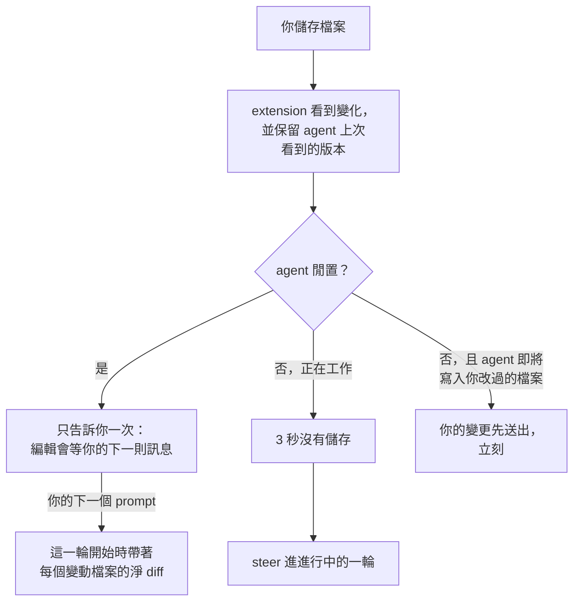

<details>
<summary>agent 收到什麼，以及它的上限</summary>

儲存不會一次一次送出：agent 拿到的是每個檔案自它上次看到的版本以來的淨變化，寫成零上下文的 diff（`@@` 標頭帶行號），一則訊息、每個檔案一段。閒置時，它會附在你的下一則訊息；agent 工作時，則在你停止儲存 3 秒後 steer 進去；agent 要寫你改過的檔案之前，你的變更會先送出。中間的儲存永遠不會到達 agent，在回報前被復原的變更什麼都不送，超過 200 行的 diff 會被截斷並註明省略的行數。與 agent 自己的寫入在同一瞬間發生的儲存不會被回報。

訊息寫成 `User edited notes.md:`，接著是 `diff` fence 裡的 diff。你儲存時若有 shell 指令正在執行，則改寫成 `notes.md changed while a shell command ran; this may include the command's own changes, not only the user's edits:`。

</details>

### 即時重新載入與關閉

開啟的分頁跟著檔案走：agent 編輯顯示中的文件（`write`、`edit` 或 `bash`）時，分頁會重新載入。你關掉最後一個分頁後，伺服器 30 秒後停止，下一次 `show_doc` 會啟動新的並再次開啟它的頁面；顯示一個你關掉分頁的頁面，會重新開啟它。

### Mini SDD

agent 寫了標頭是 `Status: proposed` 的 `docs/specs/<slug>/spec.md` 時，該資料夾的 `decision.md`、`spec.md`、`design.md` 與 `verification.md` 會自己以頁面開啟（只在 pi 有 UI 時）；之後才寫的階段檔會跟著加入。`PI_BETTER_SHOW_AUTO_OPEN=off` 可以停用。

### 事件匯流排

其他檢視器（pi-straw-boss 的 GUI）透過 `pi.events` 讀取同一批文件，所以契約有版本：每個 payload 都帶 `version: 2`。

<details>
<summary>四個事件</summary>

| 事件 | Payload |
|---|---|
| `better-show:documents` | `{version, documents}`，每次變動（文件被顯示、被 agent 修改或被你儲存、頁面被關閉）都完整送出，session 結束時送 `[]`。每一項是 `{id, kind: "blocks" \| "html" \| "text", display, reason, revision, onScreen, capability?, assets?}`。沒有路徑：`display` 是相對於工作目錄，否則是 `~` 路徑，再否則是檔名。頁面伺服器執行期間，對在畫面上或在編輯器中開啟的文件，`capability` 是提供該文件的 URL（`blocks` 與 `text` 是 Markdown 文字；`html` 是 frame 載入的頁面，要放在帶 `sandbox="allow-scripts allow-forms"` 的 iframe 中顯示），`assets` 是它的相對參照所解析的目錄 URL。清單保留最近的 32 份文件。 |
| `better-show:documents-request` | `{version}` 要求再送一次清單；它會在 `better-show:documents` 上送出一次。別的 `version`，或 session 結束後的請求，會被忽略。 |
| `better-show:answer` | `{version, id, answerId, answer}`，`answer` 是一個 `Answer`。它到達 agent 時，與頁面作答產生的訊息相同。 |
| `better-show:answer-result` | `{version, id, answerId, accepted, reason?}`；`reason` 是 `closed`、`invalid`（版本或形狀錯誤，或是 `text` 文件）、`empty`，或傳遞錯誤。重複的 `answerId` 會拿回第一次的結果，且不會再傳遞一次。沒有字串 `id` 與 `answerId` 的 payload 得不到回覆。 |

在 frame 中顯示 `html` 文件的檢視器，會以 frame 傳來的 `postMessage({source: "pbs-frame", type: "answer", answerId, answer})`（origin 為 `"null"`）收到它的答案，並回覆 `{source: "pbs-host", type: "answer-result", answerId, accepted, reason?}`。使用者在 frame 中的選取一有變化（清除時 `text` 為空），它也會收到 `{source: "pbs-frame", type: "selection", text, top?, left?}`，並可以用它提供自己的意見面板。

</details>

### 從 pi-herdr-doc-review 遷移

移除它並安裝這個套件；`show_doc` 保留名稱與參數。不再有的：Herdr pane、nvim 與 vim、Chawan 與 terminal-browser，以及 `<pi-*>` page-kit 標籤（改寫 `form`、`review`、... 區塊，或使用 `pbs-*` 元素）。事件名稱從 `doc-review:*`（版本 1）改為 `better-show:*`（版本 2）。

不用 pi 也能試：`bun run show` 在 `examples/` 上啟動頁面伺服器，並附一個假的 pi，印出 agent 會收到的每則訊息。
