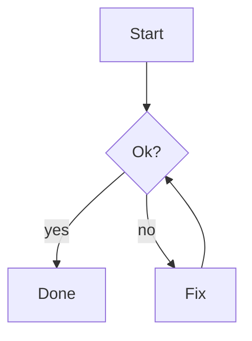

# Release plan

Every kind of block, as an agent would write it. 這一頁同時有中文與英文內容。

> [!WARNING] Heads up
> This **overwrites** the cache, see [the runbook](https://example.com/runbook).
>
> - back up first
> - then run `make release`

> [!TIP]
> 備份完成後再執行，可以隨時回復。

```cards
- {title: Speed, tone: ok, body: "**2x** faster than the old path"}
- {title: Risk, tone: warn, body: "Needs a migration window"}
- {title: Cost, tone: risk, body: "Doubles the cache memory"}
- {title: Neutral, body: "No tone, plain card"}
```

```options
- title: SQLite
  recommended: true
  body: Embedded, zero setup
  pros: [simple, fast]
  cons: [single writer]
- title: Postgres
  body: A server to run
  pros: [concurrent writers]
  cons: [more to operate, needs backups]
```

```form
title: Decide the store
questions:
  - name: store
    label: Which store?
    required: true
    hint: Pick one
    choices:
      - SQLite
      - {value: pg, label: Postgres, note: heavier, recommended: true}
  - name: extras
    label: Extras
    type: multi
    other: Anything else
    choices: [TTL, WAL, Backups]
  - name: why
    label: Why that one?
```

```review
title: Landing page
pick: true
columns: 2
items:
  - {name: A, label: dark header, image: a.svg, body: "Calm, **high contrast**"}
  - {name: B, label: light header, image: b.svg}
  - {name: C, label: prototype, page: proto.html, height: 220}
```

```mindmap
- Release
  - Build
    - bundle
    - sign
  - Ship
    - tag
    - announce
  - Verify
```

```suggest
- Go ahead
- {label: Not now, text: "Not now, ask me tomorrow"}
- 先看差異
```

```checklist
title: Before release
items:
  - {label: Run tests, checked: true}
  - {label: Bump version, note: semver}
  - {label: 更新 CHANGELOG}
```

```table
columns:
  - name
  - {name: size, label: Size, type: number}
  - {name: day, label: Shipped, type: date}
rows:
  - [alpha, 1204, 2026-03-01]
  - [beta, 2, 2026-01-15]
  - [gamma, 87, 2026-02-09]
  - [item 10, 7, 2026-04-01]
  - [item 9, 8, 2026-05-01]
sort: -size
filter: true
```

```steps
items:
  - {title: Design, status: done, when: Mon}
  - {title: Build, status: doing, when: Tue, body: "Two of **four** services left"}
  - {title: Legal review, status: blocked, body: Waiting on the vendor}
  - {title: Ship, status: todo}
```

```stats
- {label: Users, value: "1,204", delta: "+4%", tone: ok}
- {label: Errors, value: "3", delta: "-2", tone: ok, note: last hour}
- {label: Latency p95, value: 420 ms, delta: "+60 ms", tone: risk}
- {label: Builds, value: "18"}
```

```diff
diff --git a/cache.ts b/cache.ts
--- a/cache.ts
+++ b/cache.ts
@@ -1,4 +1,5 @@
 export function get(key: string) {
-  return store.get(key);
+  const hit = store.get(key);
+  return hit ?? load(key);
 }
```


