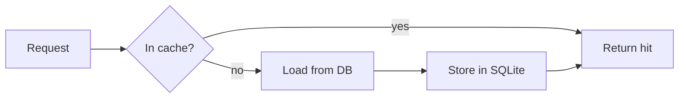

# Where the cache change lands

```tree
api/
  src/ # request handlers and services
    cache/ {focus} # everything this change touches
      store.ts {changed} # get() falls back to load()
      sqlite.ts {new} # the new backend
      memory.ts {removed}
    routes/
  tests/
    cache.test.ts {changed}
  README.md
```



```diff
diff --git a/src/cache/store.ts b/src/cache/store.ts
--- a/src/cache/store.ts
+++ b/src/cache/store.ts
@@ -1,4 +1,5 @@
 export function get(key: string) {
-  return memory.get(key);
+  const hit = sqlite.get(key);
+  return hit ?? load(key);
 }
```
