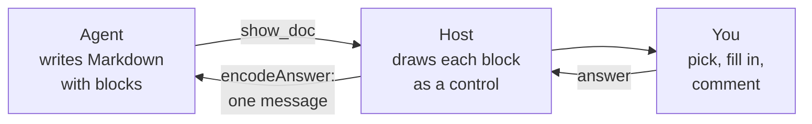
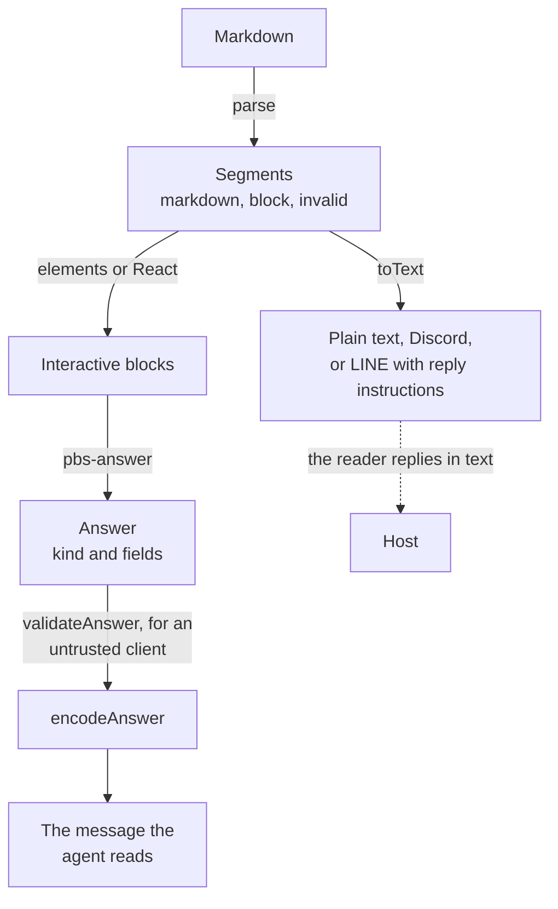

pi-better-show has two halves.
The vocabulary says what an agent may show and what a reader may answer: blocks, and the answers that come back.
A host draws the blocks and carries the answers; the pi extension is one host.

## The round trip

The agent writes Markdown with fenced blocks, a host renders them as interactive controls, and what the reader does comes back to the agent as one message.

<!-- Diagram: src/extension/tool.ts (show_doc), src/extension/controller.ts (show, decide, deliver), src/core/parse.ts (parse), src/core/answer.ts (encodeAnswer). -->

The same trip in detail

[The pi extension reference](/pi-better-show/reference/the-pi-extension/#tool) draws the whole call: the page server, the browser tab, the answer's checks, and the reload when the agent edits the file.

## Blocks

A block is a fenced code block whose first word is its kind: `options`, `form`, `table`, `mermaid`, and so on, or a GitHub alert (`> [!NOTE]`).
Most take YAML; text fields take bold, italic, code, and links, never raw HTML.
The agent writes what to show, and the host owns how it looks.

A block that does not parse becomes an `invalid` segment that keeps its source and the reason, so the page shows the problem instead of dropping the block. [The block reference](/pi-better-show/reference/blocks/) has every kind.

## Parse, draw, answer

Every host runs the same three steps, and the first and the last live in core, so they cannot drift between hosts.

<!-- Diagram: src/core/parse.ts (parse, locate), src/core/text.ts (toText), src/elements/index.ts (pbs-* elements, pbs-answer), src/core/validate.ts (validateAnswer), src/core/answer.ts (encodeAnswer). -->

Where each step lives

- `parse` splits a document into `markdown`, `block`, and `invalid` segments; a block's `index` is its address for answers.
- The elements draw a block and fire `pbs-answer` with an `Answer`; the React wrappers sit on top of them. A surface that cannot draw them uses `toText`.
- `validateAnswer` checks an `Answer` from an untrusted client against the block it claims to answer. The pi extension checks the answer's shape and origin instead, since its own page sends it.
- `encodeAnswer` writes the text the agent reads.

## Answers

An answer has a kind and a list of `[name, value]` fields, and each kind reads as a fixed message.

| Kind | Comes from | The agent reads |
| --- | --- | --- |
| `pick` | `options` | `User picked "SQLite".` |
| `form` | `form`, and `<form>` on an HTML page | `User submitted a form ...` then `- name: value` lines |
| `review` | `review` | `User reviewed "title":` with the pick and each comment |
| `suggest` | `suggest` | the chip's text itself |
| `checklist` | `checklist` | `User updated the checklist ...` then `☑` and `☐` lines |
| `feedback` | the feedback panel | `User feedback on the page ...` with quotes and comments |

Details

- A pick or a chip sends at once; a form, a checklist, and a review stay editable until you press Send.
- Every submittable block has an "Other comments" box; its text arrives as a last line, `Other comments: ...`.
- A message from a page the agent wrote itself starts with `Agent page <name> sent:`, so the agent can tell it from a click on a block.

## Text fallback

A surface that cannot draw blocks (a chat, a terminal) gets the same document as text: `toText` turns each block into Markdown or plain text, with a reply instruction for the interactive kinds ("Reply with a number.").
A diagram becomes Unicode box drawing when it fits, else its source plus a pointer to the web view.
The agent writes one document, whatever shows it.

## One vocabulary, many hosts

The pi extension is the first host, not the only one: the same blocks, the same answers, and the same words work in a GUI or a chat bridge. [Hosts](/pi-better-show/guide/hosts/) shows how one is built.

## Next

- [Quick start](/pi-better-show/guide/quick-start/): a first page.
- [Feedback](/pi-better-show/guide/feedback/): commenting on text and diagrams.
- [Hosts](/pi-better-show/guide/hosts/): using the library.
