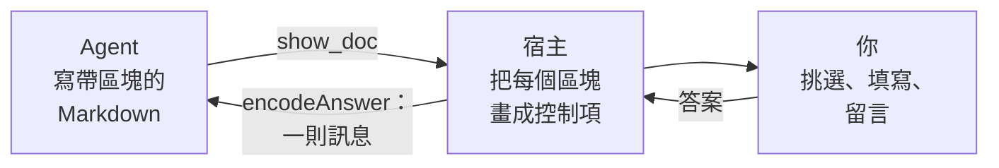
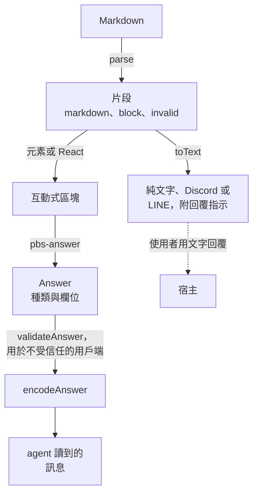

pi-better-show 有兩半。
詞彙說明 agent 可以顯示什麼、使用者可以回答什麼：區塊，以及送回來的答案。
宿主負責畫出區塊並傳遞答案；pi extension 是其中一個宿主。

## 一來一往

agent 寫帶有 fence 區塊的 Markdown，宿主把它們渲染成互動式控制項，使用者做的事再以一則訊息送回給 agent。

<!-- Diagram: src/extension/tool.ts (show_doc), src/extension/controller.ts (show, decide, deliver), src/core/parse.ts (parse), src/core/answer.ts (encodeAnswer). -->

同一趟的細節

[pi extension 參考](/pi-better-show/zh-tw/reference/the-pi-extension/#工具)畫出整個呼叫：頁面伺服器、瀏覽器分頁、答案的檢查，以及 agent 編輯檔案時的重新載入。

## 區塊

區塊是第一個字為種類名稱的 fenced code block：`options`、`form`、`table`、`mermaid` 等等，或是 GitHub alert（`> [!NOTE]`）。
多數吃 YAML；文字欄位吃粗體、斜體、程式碼與連結，絕不接受原始 HTML。
agent 寫要顯示什麼，外觀由宿主負責。

無法剖析的區塊會變成保留原始碼與原因的 `invalid` 片段，所以頁面會顯示問題，而不是把區塊丟掉。[區塊參考](/pi-better-show/zh-tw/reference/blocks/)列出每一種。

## 剖析、繪製、作答

每個宿主都走同樣三步，第一步與最後一步在 core 裡，所以宿主之間不會漂移。

<!-- Diagram: src/core/parse.ts (parse, locate), src/core/text.ts (toText), src/elements/index.ts (pbs-* elements, pbs-answer), src/core/validate.ts (validateAnswer), src/core/answer.ts (encodeAnswer). -->

每一步在哪裡

- `parse` 把文件切成 `markdown`、`block` 與 `invalid` 片段；區塊的 `index` 是答案用來定位它的位址。
- 元素畫出區塊並以一個 `Answer` 觸發 `pbs-answer`；React 包裝建立在它們之上。畫不出它們的介面使用 `toText`。
- `validateAnswer` 對照答案所稱要回答的區塊，檢查來自不受信任用戶端的 `Answer`。pi extension 改為檢查答案的形狀與來源，因為答案是它自己的頁面送的。
- `encodeAnswer` 寫出 agent 讀的文字。

## 答案

答案有一個種類與一串 `[name, value]` 欄位，每個種類都寫成固定的訊息。

| 種類 | 來自 | agent 讀到 |
| --- | --- | --- |
| `pick` | `options` | `User picked "SQLite".` |
| `form` | `form`，以及 HTML 頁面上的 `<form>` | `User submitted a form ...` 後面接 `- name: value` 各行 |
| `review` | `review` | `User reviewed "title":`，附挑選與每則留言 |
| `suggest` | `suggest` | chip 的文字本身 |
| `checklist` | `checklist` | `User updated the checklist ...` 後面接 `☑` 與 `☐` 各行 |
| `feedback` | 意見面板 | `User feedback on the page ...`，附 quote 與留言 |

細節

- 挑選或 chip 會立刻送出；表單、checklist 與 review 在你按 Send 之前都可以再編輯。
- 每個可送出的區塊都有「Other comments」欄位；它的文字會以最後一行 `Other comments: ...` 送達。
- agent 自己寫的頁面送來的訊息以 `Agent page <name> sent:` 開頭，所以 agent 分得出它與對區塊的點擊。

## 純文字備援

畫不了區塊的介面（聊天、終端機）會以文字拿到同一份文件：`toText` 把每個區塊轉成 Markdown 或純文字，互動種類附上回覆指示（「Reply with a number.」）。
圖放得下時會變成 Unicode 框線，否則是它的原始碼加上指向網頁版的提示。
agent 寫一份文件，不管是什麼在顯示它。

## 一套詞彙，許多宿主

pi extension 是第一個宿主，不是唯一的：同樣的區塊、同樣的答案與同樣的用字，在 GUI 或聊天橋接裡也能用。[宿主](/pi-better-show/zh-tw/guide/hosts/)說明怎麼建一個。

## 接著

- [快速開始](/pi-better-show/zh-tw/guide/quick-start/)：第一個頁面。
- [意見](/pi-better-show/zh-tw/guide/feedback/)：對文字與圖留言。
- [宿主](/pi-better-show/zh-tw/guide/hosts/)：使用函式庫。
