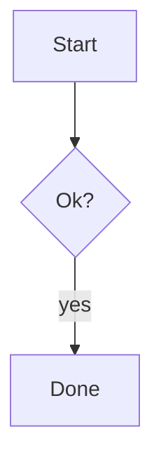

# Release plan

Intro with **bold**, *italic* and `code`, see [docs](https://example.com/docs).

> [!WARNING] Heads up
> This **overwrites** the cache.



```diff
@@ -1,2 +1,2 @@
-old
+new
```

```cards
- {title: Speed, tone: ok, body: "**2x** faster"}
- {title: Risk, tone: warn}
```

```options
- title: SQLite
  recommended: true
  body: Embedded
  pros: [simple, fast]
  cons: single writer
- title: Postgres
  body: Server
```

```form
title: Decide
questions:
  - name: store
    label: Which store?
    required: true
    hint: Pick one
    choices:
      - SQLite
      - {value: pg, label: Postgres, note: heavier, recommended: true}
  - label: Anything else?
```

```review
title: Landing page
pick: true
items:
  - {name: A, label: dark, image: a.png}
  - {page: proto/b.html, body: Light variant}
```

```mindmap
- Release
  - Build
    - bundle
  - Ship
```

```suggest
- Go ahead
- {label: Not now, text: "Not now, ask me tomorrow"}
```

```checklist
title: Before release
items:
  - {label: Run tests, checked: true}
  - {label: Bump version, note: semver}
```

```table
columns:
  - name
  - {name: size, label: Size, type: number}
rows:
  - [alpha, 10]
  - [beta, 2]
sort: -size
filter: true
```

```steps
items:
  - {title: Design, status: done, when: Mon}
  - {title: Build, status: doing, body: In progress}
  - {title: Ship}
```

```stats
- {label: Users, value: 1204, delta: +4%, tone: ok}
- {label: Errors, value: 3, note: last hour}
```

```tree
app/
  src/ # sources
    main.ts {changed}
  README.md {new}
```

Closing line.
